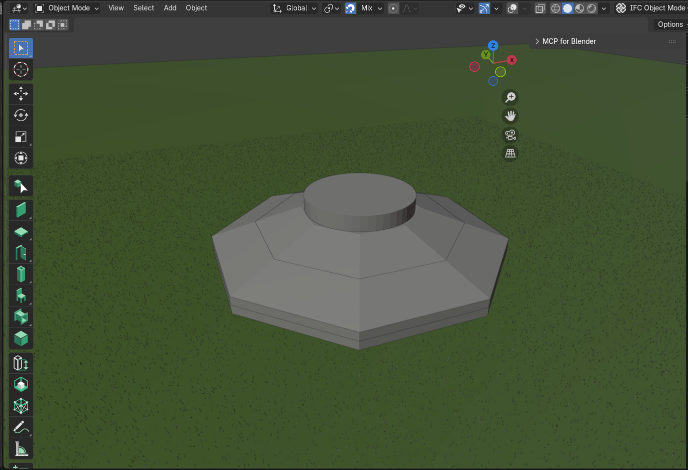

# E06 · Dossier de verificación y BIM de la fundación

Benjamín García, Luis Noriega y Matias Stierling · Grupo 6

Métodos Computacionales en Obras Civiles · 29 de octubre de 2026

El repositorio del proyecto es [Proyecto 2 MCOC](https://github.com/benjagarciag/Proyecto-2-MCOC). El código y el IFC evaluados corresponden al commit [3cca1a5663e3a1a459e9f4493a92ede69b20b810](https://github.com/benjagarciag/Proyecto-2-MCOC/commit/3cca1a5663e3a1a459e9f4493a92ede69b20b810). Este dossier reúne la evidencia obtenida sobre esa versión, sin modificar el núcleo numérico ni el modelo BIM.

## Propósito y alcance

Antes de aplicar el solver a la fundación, comprobamos su respuesta en problemas cuya solución conocemos. Para ello utilizamos referencias analíticas y balances independientes de energía. Además, revisamos el IFC guardado para verificar que las cinco vertidas puedan identificarse y leerse desde Python sin depender de una sesión abierta de Blender.

La ejecución completa de la batería terminó con **320 pruebas aprobadas en 11,70 s**. Los estudios adicionales de este dossier también cumplieron sus criterios. Estos resultados verifican la implementación en los casos ensayados; la validación térmica de la fundación con mediciones sigue siendo una etapa posterior.

## Matriz de verificación

En los estudios de convergencia usamos el error máximo final, definido como $e_\infty=\max_i|T_i-T_{\mathrm{ref},i}|$. El orden observado se calcula mediante $p=\log_2(e_h/e_{h/2})$.

| Test | Qué verifica | Error o métrica | Resultado |
| --- | --- | --- | --- |
| Batería completa | Solvers 1D, 2D y 3D, bordes, fuentes, materiales, criterios térmicos y casos auxiliares | 320 aprobados y 0 fallidos | Aprobado |
| Convergencia espacial | Diferencias centrales al reducir Δx con Δt fijo | Orden entre 2,003 y 2,043; criterio entre 1,9 y 2,1 | Aprobado |
| Convergencia temporal | Avance explícito al reducir Δt con malla fija | Orden entre 1,0001 y 1,0006; criterio entre 0,95 y 1,05 | Aprobado |
| Energía adiabática | Conservación con campo inicial no uniforme y sin fuente | Máxima variación de 4,55 × 10⁻¹³ J, menor que 10⁻⁹ J | Aprobado |
| Fuente uniforme | Conversión de generación volumétrica en aumento de temperatura | Error de 7,11 × 10⁻¹⁴ K, menor que 10⁻¹⁰ K | Aprobado |
| Robin | Potencia de intercambio y balance por paso | Potencia inicial de −43,076923 W; residuo máximo de 5,17 × 10⁻¹³ J, menor que 10⁻¹⁰ J | Aprobado |
| BIM base | Identidad, siete propiedades y geometría triangulable | Cinco IfcFooting legibles en IFC4 | Aprobado para esta lectura |

## Convergencia espacial y temporal

Elegimos una barra de 1 m con extremos a 20 °C, difusividad de 10⁻⁴ m²/s y perfil inicial sinusoidal de amplitud 50 K. A los 1000 s, la referencia continua es

$$
T(x,t)=20+50\sin(\pi x/L)\exp[-\alpha(\pi/L)^2t].
$$

Primero mantuvimos Δt en 0,01 s y refinamos únicamente el espacio. El error disminuyó aproximadamente cuatro veces al dividir Δx por dos, como corresponde a un esquema de segundo orden. El pequeño error temporal remanente explica la desviación del orden respecto de dos.

| Intervalos | Δx [m] | Error espacial final [K] | Orden observado |
| ---: | ---: | ---: | ---: |
| 10 | 0,1000 | 0,151296 | — |
| 20 | 0,0500 | 0,037735 | 2,003 |
| 40 | 0,0250 | 0,009364 | 2,011 |
| 80 | 0,0125 | 0,002273 | 2,043 |

Luego fijamos 40 intervalos y redujimos únicamente Δt. Para aislar el error temporal comparamos con la solución exacta del sistema espacial semidiscreto. Esta conserva el seno y reemplaza la tasa continua por $\lambda_h=4\alpha\sin^2(\pi\Delta x/(2L))/\Delta x^2$. Así evitamos que el error espacial oculte la convergencia temporal. Todos los pasos respetan el límite explícito de 3,125 s para esta malla.

| Δt [s] | Error temporal final [K] | Orden observado |
| ---: | ---: | ---: |
| 2,00 | 0,018158 | — |
| 1,00 | 0,009075 | 1,0006 |
| 0,50 | 0,004537 | 1,0003 |
| 0,25 | 0,002268 | 1,0001 |

## Energía, fuente y condición Robin

Para estos ensayos usamos un dominio de 3 × 2 m, espesor de 0,7 m y malla de 6 × 4 celdas, con k de 2 W/(m K), ρ de 3 kg/m³ y cₚ de 4 J/(kg K). Son propiedades sintéticas que permiten verificar rápidamente el balance; no caracterizan el hormigón del caso real. Integramos durante 1 s con pasos de 0,01 s.

En el ensayo adiabático partimos del campo $T(x,y,0)=30+5\cos(\pi x/3)+2\sin(\pi y/2)$, con todas las caras aisladas. Aunque las temperaturas se redistribuyen, la energía calculada directamente desde los campos, $E=\sum_i\rho c_p V_iT_i$, permanece constante dentro del redondeo numérico. La variación máxima fue de 4,55 × 10⁻¹³ J, una cantidad prácticamente nula frente a la energía del dominio.

Al agregar una fuente uniforme de 60 W/m³ desde 20 °C, la solución adiabática exacta es $T=20+60t/(\rho c_p)$. El solver reproduce su pendiente de 5 K/s y alcanza 25 °C al finalizar.

Finalmente, aplicamos Robin solamente en la cara x máxima y mantuvimos las demás aisladas, con h de 5 W/(m² K), ambiente a 20 °C e inicio uniforme a 30 °C. Calculamos independientemente la potencia mediante $P=A(T_{amb}-T_c)/(\Delta x/(2k)+1/h)$. Su signo negativo representa enfriamiento. Además, comprobamos que cada cambio de energía coincide con el calor intercambiado durante ese paso. La diferencia máxima entre ambas cantidades fue de 5,17 × 10⁻¹³ J.

## BIM base y simplificaciones geométricas



*Figura 1. Captura del modelo en Blender. Se distinguen la base octagonal, la transición inclinada hacia el centro y el pedestal cilíndrico superior. El terreno verde forma parte de la presentación visual; las dimensiones indicadas en la tabla se obtuvieron del IFC.*

La lectura del [IFC versionado](../desarrollo/fundacion/fundacion.ifc) recuperó cinco objetos IfcFooting con GUID propio y las siete propiedades del conjunto UANDES_HormigonMasivo. El archivo conserva 19 °C en la primera vertida y 18 °C en las restantes, como datos de práctica. Inicio_h representa el inicio planificado relativo; moldaje y aislación siguen pendientes de definición.

| Vertida | Envolvente X × Y × Z [m] | Intervalo vertical [m] |
| --- | --- | --- |
| 01 | 18 × 18 × 0,55 | 0–0,55 |
| 02 | 18 × 18 × 0,55 | 0,55–1,10 |
| 03 | 18 × 18 × 1,10 | 1,10–2,20 |
| 04 | 12,50 × 12,50 × 1,10 | 2,20–3,30 |
| 05 | 7 × 7 × 1,00 | 3,30–4,30 |

Las simplificaciones adoptadas se declaran explícitamente.

1. La planta se representa mediante un octágono regular de 18 m entre caras opuestas.
2. La variación de espesor se aproxima mediante dos troncos octagonales, con transición intermedia de 12,50 m y plataforma superior de 7 m.
3. El pedestal se aproxima mediante un cilindro facetado de 7 m de diámetro y 1 m de altura. Esta altura es una adopción docente.
4. La división en cinco volúmenes reproduce la guía de Bonsai y todavía no constituye un plan de vertidas optimizado.
5. Se omiten armaduras, pernos, ductos, detalles de juntas y geometría del suelo.

Estas decisiones siguen la [guía docente](../Enunciados%20e%20Instrucciones/Guias/GUIA_BONSAI_FUNDACION.md), sujetas a una geometría oficial posterior. La triangulación no demuestra ausencia de solapes ni estanqueidad. Tampoco se ha conectado aún este BIM al solver mediante voxelización.

## Reproducción de la evidencia

El IFC está incluido en el commit declarado. Con Python 3.12 y las dependencias de requirements.txt, la batería y la lectura BIM se reproducen desde la raíz mediante

```powershell
.\.venv\Scripts\python.exe -B -m pytest -q -p no:cacheprovider
.\.venv\Scripts\python.exe -B desarrollo/fundacion/verificar_ifc.py
```

Para repetir exactamente las tablas y los balances adicionales, se copia el bloque completo siguiente en PowerShell desde la raíz del proyecto. Solo imprime resultados y comprueba tolerancias, sin guardar archivos. Las pequeñas diferencias en las últimas cifras pueden depender del redondeo del equipo.

```powershell
@'
import sys
sys.path.insert(0, 'desarrollo')
import numpy as np
from mcplan.difusion_1d import Parametros1D, resolver_1d
from mcplan.difusion_2d import Parametros2D
from mcplan.difusion_bordes import resolver_2d_bordes
from mcplan.bordes_termicos import Neumann, Robin

for estudio in ('espacial', 'temporal'):
    errores = []
    valores = (10, 20, 40, 80) if estudio == 'espacial' else (2, 1, .5, .25)
    for valor in valores:
        n, dt = (valor, .01) if estudio == 'espacial' else (40, valor)
        p = Parametros1D(n_intervalos=n, paso_tiempo_s=dt,
            tiempo_final_s=1000, perfil_inicial='seno', amplitud_inicial_K=50,
            temperatura_izquierda_C=20, temperatura_derecha_C=20)
        r = resolver_1d(p)
        tasa = 1e-4*np.pi**2
        if estudio == 'temporal':
            tasa = 4e-4*np.sin(np.pi*p.dx_m/2)**2/p.dx_m**2
        exacta = 20+50*np.sin(np.pi*r.x_m)*np.exp(-tasa*1000)
        error = np.max(abs(r.temperatura_C[-1]-exacta))
        errores.append(error)
        print(estudio, 'dx, dt, error [K]:', p.dx_m, p.dt_s, error)
    ordenes = np.log2(np.array(errores[:-1])/errores[1:])
    minimo, maximo = (1.9, 2.1) if estudio == 'espacial' else (.95, 1.05)
    assert np.all((ordenes > minimo) & (ordenes < maximo))
    print('Ordenes:', ordenes)

p = Parametros2D(longitud_x_m=3, longitud_y_m=2, espesor_m=.7,
    celdas_x=6, celdas_y=4, conductividad_W_mK=2,
    densidad_kg_m3=3, calor_especifico_J_kgK=4,
    tiempo_final_s=1, paso_tiempo_s=.01)
caras = {f'{e}_{lado}': Neumann(0) for e in 'xy' for lado in ('min', 'max')}
def resolver(bordes, inicial, fuente=0):
    return resolver_2d_bordes(p, bordes, inicial,
        fuente_W_m3=fuente, n_guardados=10000)
def energia(r):
    return 12*p.dx_m*p.dy_m*.7*r.temperatura_C.sum(axis=(1, 2))
adiabatico = resolver(caras,
    lambda x, y: 30+5*np.cos(np.pi*x/3)+2*np.sin(np.pi*y/2))
residuo_E = np.max(abs(energia(adiabatico)-energia(adiabatico)[0]))
fuente = resolver(caras, 20, 60)
error_Q = np.max(abs(fuente.temperatura_C-(20+5*fuente.tiempos_s[:, None, None])))
robin = resolver(dict(caras, x_max=Robin(5, 20)), 30)
potencia = 1.4*(20-robin.temperatura_C[:-1, :, -1]).mean(axis=1)/(.25/2+1/5)
residuo_R = np.max(abs(np.diff(energia(robin))-robin.dt_s*potencia))
assert residuo_E < 1e-9 and error_Q < 1e-10 and residuo_R < 1e-10
assert abs(potencia[0]+43.07692307692308) < 1e-12
print('Energia [J], fuente [K], potencia Robin [W], residuo Robin [J]:')
print(residuo_E, error_Q, potencia[0], residuo_R)
print('Verificaciones adicionales aprobadas.')
'@ | .\.venv\Scripts\python.exe -B -
```

Esta entrega comprueba el funcionamiento básico del solver y la lectura del BIM. Todavía no evalúa el calor de hidratación calibrado con datos del hormigón, las condiciones meteorológicas ni la probabilidad de superar los límites térmicos de la fundación.
