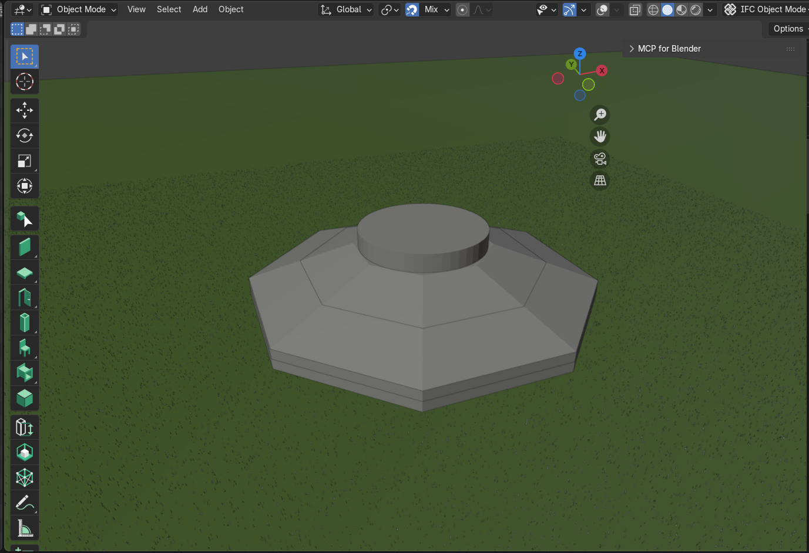
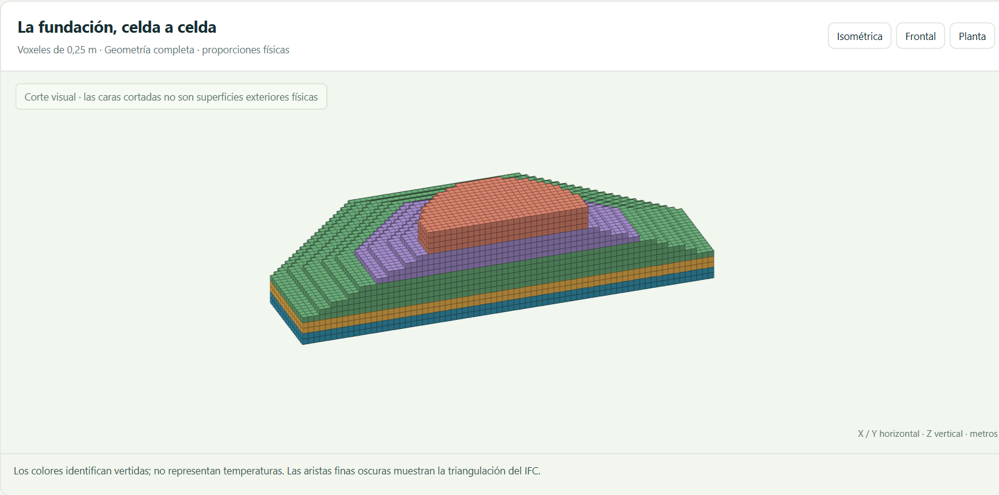
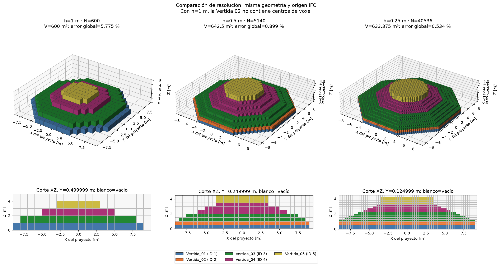
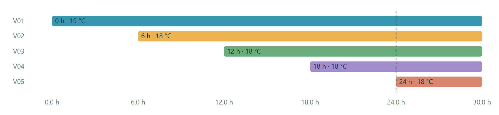
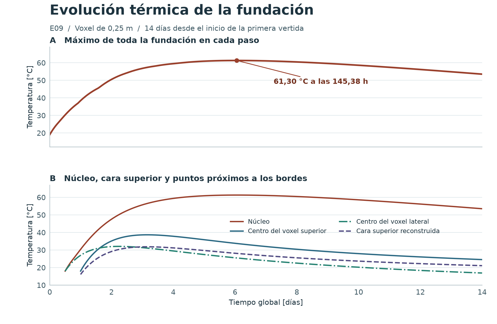
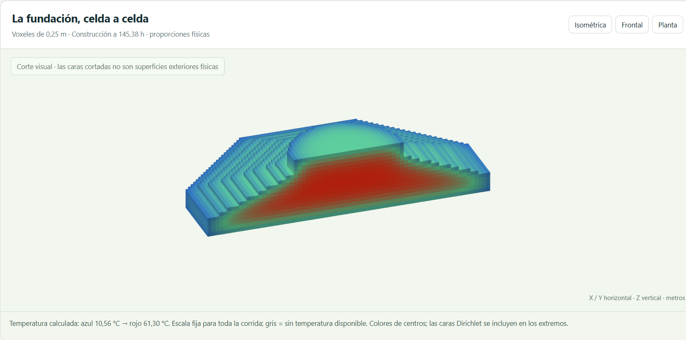
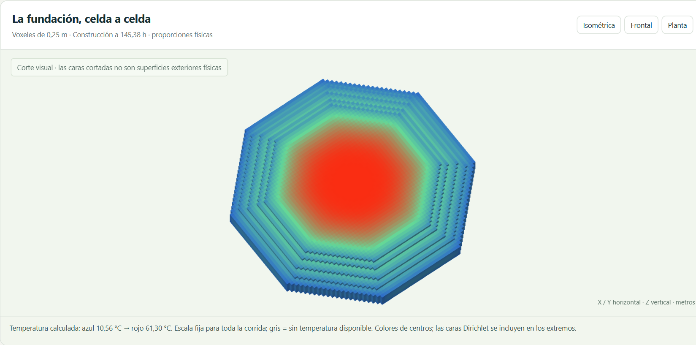
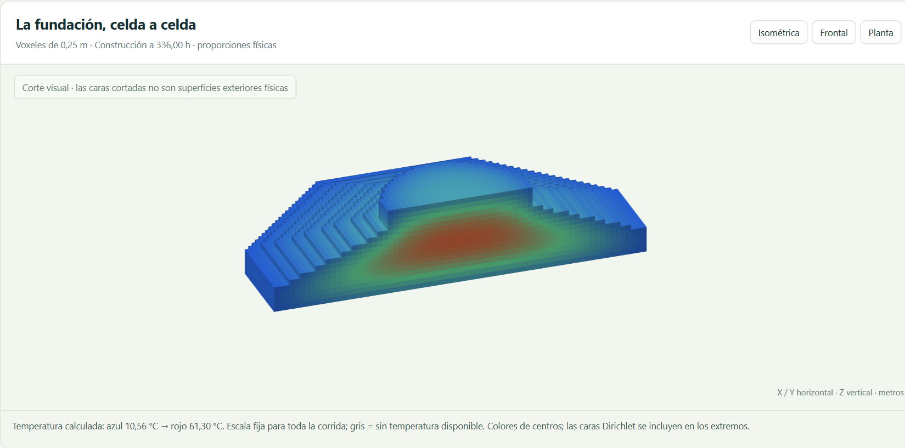

# E09 — Simulación térmica 3D de la fundación con hidratación

**Métodos Computacionales en IOC · Proyecto 2 · Grupo 6**

**Repositorio** [benjagarciag/Proyecto-2-MCOC](https://github.com/benjagarciag/Proyecto-2-MCOC)

**Commit evaluado** [`8c074ca99749963541b4e212132a29552c396df6`](https://github.com/benjagarciag/Proyecto-2-MCOC/commit/8c074ca99749963541b4e212132a29552c396df6)

El **máximo global fue 61,30 °C a las 145,38 h (6,06 días)**, cerca del eje de V03 a 2,125 m de altura. A las 336 h bajó a 53,52 °C.

## 1. Del BIM a la malla de cálculo

El IFC contiene cinco sólidos, con planta envolvente de 18 × 18 m, cuerpo de 3,30 m y coronación cilíndrica de 7 m de diámetro y 1 m de alto.

**Cómo se construye la grilla.** Se cubre el IFC con cubos de lado $\ell=\Delta x=\Delta y=\Delta z$ desde su esquina mínima, aproximadamente $(-9,-9,0)\,\mathrm{m}$. El número de celdas por eje se redondea hacia arriba. Para la fila $j$,

$$
z_j=z_{\min}+\left(j+\tfrac12\right)\Delta z,\qquad j=0,1,2,\ldots
$$

**Cómo se etiqueta cada voxel.** Se asigna el cubo completo al sólido triangulado que contiene su centro. Los centros fuera de los sólidos quedan vacíos. El criterio por centros convierte las superficies curvas e inclinadas en escalones.

*Figura 1. Modelo BIM de la fundación. Captura de Blender/Bonsai del repositorio.*

*Figura 2. Captura del visualizador con la malla de 0,25 m seccionada para mostrar las cinco capas. De abajo hacia arriba, V01 a V05.*

Las cinco mallas IFC suman **636,775 m³**. Para $N$ celdas ocupadas de lado $\ell$,

$$
V_{\mathrm{vox}} = N\ell^3,\qquad
\varepsilon_V = \frac{V_{\mathrm{vox}}-V_{\mathrm{IFC}}}{V_{\mathrm{IFC}}}\times 100\%.
$$

La tabla global usa el valor absoluto de $\varepsilon_V$.

| Lado [m] | Grilla X × Y × Z | Ocupados | Volumen [m³] | Error absoluto relativo | Vertidas |
| --- | --- | ---: | ---: | ---: | ---: |
| 1,00 | 19 × 19 × 5 | 600 | 600,000 | 5,775 % | 4 de 5 |
| 0,50 | 37 × 37 × 9 | 5.140 | 642,500 | 0,899 % | 5 de 5 |
| **0,25** | **73 × 73 × 18** | **40.536** | **633,375** | **0,534 %** | **5 de 5** |

**Por qué aparecen cuatro vertidas con 1 m.** Como $z_{\min}=0$, las dos primeras filas tienen centros en $z=0{,}50\,\mathrm{m}$ y $z=1{,}50\,\mathrm{m}$. La V02 ocupa entre 0,55 y 1,10 m, de modo que ningún centro cae en su espesor. La fila inferior se asigna a V01 y la siguiente a V03. Esto crea un contacto artificial V01–V03 y elimina la colocación e hidratación de V02. Con $\Delta x=0{,}50\,\mathrm{m}$ aparece un centro a 0,75 m y se recupera esa capa.

**Qué cambia al reducir $\Delta x$.** Los escalones más pequeños resuelven mejor capas delgadas y bordes. De 0,50 a 0,25 m, los voxeles ocupados suben de 5.140 a 40.536, aumentando el trabajo por paso. El error global baja al refinar estas mallas. El error por capa depende de la alineación entre juntas y centros. En V03 sube de 1,04 % a 16,03 % y su exceso compensa parte del déficit de otras capas. Se eligió 0,25 m porque conserva las cinco vertidas y sus interfaces y reduce el peor error local de 37,76 % a 16,03 %.

*Figura 3. Comparación de las tres mallas a partir del mismo IFC. Los cortes XZ cercanos al eje muestran que V02 (naranja) desaparece con 1 m y se distingue en ambas mallas más finas.*

## 2. Vertidas, hidratación y condiciones de borde

| Vertida | Intervalo vertical IFC [m] | Inicio [h] | Colocación [°C] | Vol. IFC [m³] | Vol. a 0,25 m [m³] | Error firmado |
| --- | --- | ---: | ---: | ---: | ---: | ---: |
| V01 | 0,00–0,55 | 0 | 19 | 147,626 | 133,125 | −9,82 % |
| V02 | 0,55–1,10 | 6 | 18 | 147,626 | 133,125 | −9,82 % |
| V03 | 1,10–2,20 | 12 | 18 | 214,224 | 248,563 | +16,03 % |
| V04 | 2,20–3,30 | 18 | 18 | 88,925 | 80,063 | −9,97 % |
| V05 | 3,30–4,30 | 24 | 18 | 38,375 | 38,500 | +0,33 % |

Cada vertida se activa a su hora del IFC con temperatura uniforme. El hormigón previo conserva su temperatura. Las caras frente a vertidas futuras intercambian calor con el ambiente hasta que el vecino se activa y se establece contacto térmico perfecto.

*Figura 4. Captura de la secuencia en el visualizador. A las 24 h se activa la última vertida.*

La hidratación del cemento libera calor en el volumen. La edad de cada vertida es $a_i=t-t_i$, con $t_i$ igual al inicio de colocación.

$$
q_i'''(t)=
\begin{cases}
0,& t<t_i,\\
q_0\exp(-a_i/\tau),&t\ge t_i.
\end{cases}
$$

$q_0=900\,\mathrm{W\,m^{-3}}$ es la potencia inicial por volumen. $\tau=30\,\mathrm{h}$ fija el ritmo de decaimiento. A esa edad queda el $37\,\%$ del valor inicial, unos $331\,\mathrm{W\,m^{-3}}$. Antes de colocarse, el voxel está inactivo.

Para un paso que comienza después de la colocación, el calor generado por un voxel de volumen $V$ es

$$
E_{\mathrm{hid}}=Vq_0\tau
\left[e^{-a_i/\tau}-e^{-(a_i+\Delta t)/\tau}\right],
$$

con tiempos en segundos para obtener julios. El balance suma este aporte a la conducción y al intercambio exterior. El hormigón usa $k=2\,\mathrm{W\,m^{-1}\,K^{-1}}$, $\rho=2400\,\mathrm{kg\,m^{-3}}$ y $c_p=900\,\mathrm{J\,kg^{-1}\,K^{-1}}$. La fuente es didáctica, máxima al colocar e independiente de la temperatura.

Todas las caras expuestas, incluida la base, usan Robin con ambiente constante $T_\infty=10\,^\circ\mathrm{C}$ y coeficiente $h=5\,\mathrm{W\,m^{-2}\,K^{-1}}$,

$$
-k\frac{\partial T}{\partial n}=h(T_{\mathrm{cara}}-T_\infty),
$$

donde $n$ es la normal exterior. Se omiten suelo explícito, variaciones meteorológicas, radiación, moldajes y aislación. El balance usa volúmenes finitos cartesianos y Euler explícito. Se ejecutaron 1.408 pasos de 450–900 s, ajustados a las colocaciones y a los instantes de salida.

## 3. Evolución térmica y cortes

$T_{\max}(t)$ se evalúa en cada paso sobre centros activos y caras físicas reconstruidas. El núcleo acumula calor de hidratación y se enfría cuando domina la disipación. Los puntos expuestos alcanzan antes sus picos.

*Figura 5. Curvas a partir de las series de cada paso del visualizador. Las observaciones aparecen desde la activación de su vertida.*

| Observación | Centro (x, y, z) [m] | Pico [°C] | Hora del pico [h] | A 145,38 h [°C] | A 336 h [°C] |
| --- | --- | ---: | ---: | ---: | ---: |
| Núcleo · V03 | (0,125 / 0,125 / 2,125) | 61,30 | 145,38 | 61,30 | 53,52 |
| Voxel superior · V05 | (0,125 / 0,125 / 4,125) | 38,66 | 75,75 | 33,71 | 24,54 |
| Voxel lateral · V03 | (6,375 / 0,125 / 2,125) | 32,07 | 53,75 | 25,47 | 16,90 |

La cara superior se reconstruye con la condición Robin en la cara +Z del voxel superior, a $z=4{,}250\,\mathrm{m}$ en la geometría discreta. El diferencial simultáneo entre el núcleo observado y esa cara alcanza **35,08 °C a las 214,88 h (8,95 días)**. El indicador docente $S_{25}$, a 25 mm de la superficie, queda fuera del alcance de E09.

*Figura 6. Corte vertical XZ al máximo global. Los colores corresponden a los centros de la hilera seccionada en $y=0{,}125\,\mathrm{m}$. El núcleo caliente queda rodeado por bordes más fríos.*

*Figura 7. Corte horizontal XY a la cota de centros $z=2{,}125\,\mathrm{m}$ al mismo instante. Permite comparar núcleo y periferia a igual altura.*

*Figura 8. El mismo corte vertical a las 336 h. La escala fija permite comparar el enfriamiento con la figura 6.*

La hidratación aportó 61,563 GJ y el exterior extrajo 49,087 GJ. El balance, incluida la energía de colocación, dejó un residuo de 0,0013 J. Reducir el paso tope a 450 s cambió el pico en 0,006 °C. Con voxeles de 0,50 m el pico fue 61,78 °C. Queda pendiente verificar la convergencia espacial del campo y los gradientes.

## 4. Comparación con Ju y Lei (2019)

**Qué reproduce.** En ambos casos se observa acumulación de calor seguida por enfriamiento, con un núcleo más caliente y un pico interior más tardío que cerca de la superficie. También se desarrolla un gradiente vertical y el mayor diferencial núcleo–cara superior aparece después del pico interior, cerca del noveno día. El artículo informa aproximadamente 35 °C para ese diferencial. [Ju y Lei, secciones 3.1.1–3.1.2](https://onlinelibrary.wiley.com/doi/10.1155/2019/7029671)

**Qué falta reproducir o validar.** El núcleo medido por Ju y Lei alcanzó unos 73 °C alrededor del cuarto día, frente a 61,30 °C cerca del sexto día global en esta corrida. El ambiente constante omite las oscilaciones superficiales medidas. La semejanza del diferencial es descriptiva. Una validación exigiría sondas equivalentes, calibración de la fuente y bordes representativos de la obra. [Ju y Lei, secciones 3.1 y 3.2](https://onlinelibrary.wiley.com/doi/10.1155/2019/7029671)

## Reproducción

Abrir `Visualizadores/E07.html` del SHA indicado. Cargar [escenario-e09.json](E09/escenario-e09.json) en **Construcción** y pulsar **Calcular temperaturas** en **Ecuación de calor**. Para cada serie local, ingresar sus coordenadas con punto decimal y recalcular. La [serie por paso](E09/series-e09.csv) incluye la temperatura de la cara superior, reconstruida desde el centro del voxel con Robin,

$$
T_{\mathrm{cara}}=T_\infty+
\frac{T_{\mathrm{centro}}-T_\infty}{1+\dfrac{h\,\Delta z}{2k}},
$$

donde $\Delta z$ es el lado del voxel. Capturas complementarias de la [triangulación IFC](E09/figuras/02-ifc-en-visualizador.png) y la [curva térmica](E09/figuras/05-tmax-visualizador.png).
