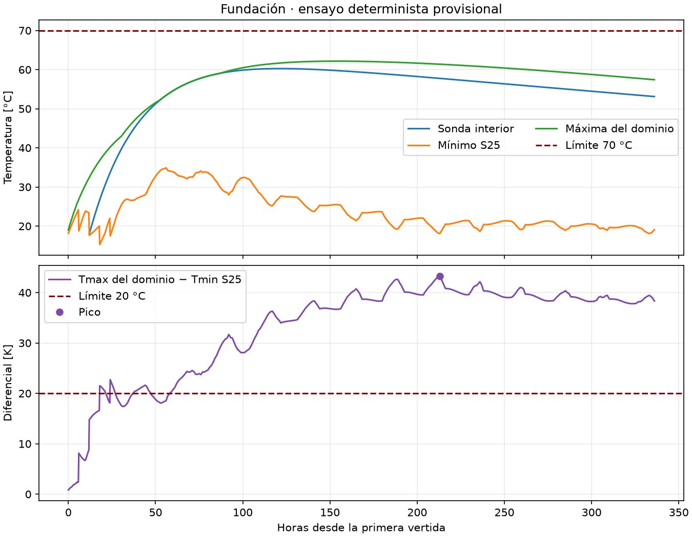
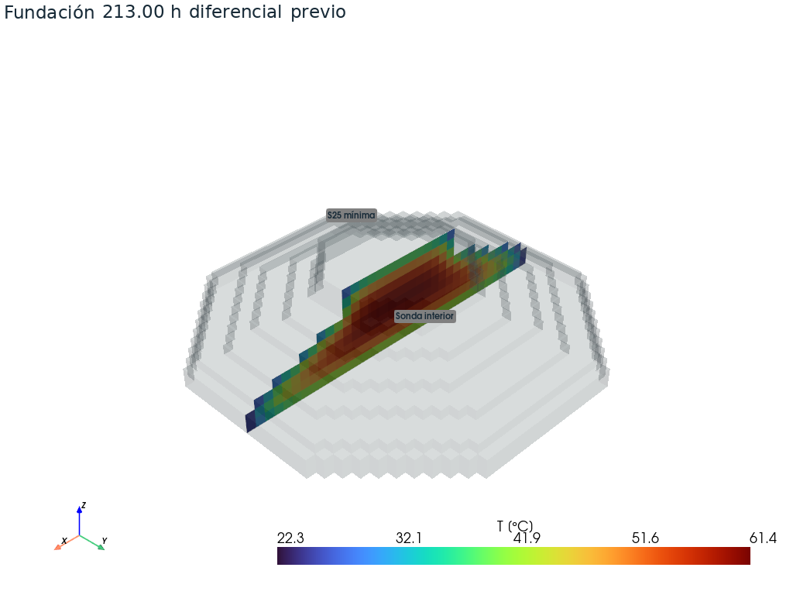

# E12 — Simulación térmica determinista de 14 días

**Repositorio** [benjagarciag/Proyecto-2-MCOC](https://github.com/benjagarciag/Proyecto-2-MCOC)

**Código simulado** `5b6aebfc3143f7a62fdb2efbaf95bdb9457ee91a`. El resumen registra este SHA y los parámetros efectivos. El SHA del paquete final se declara en Canvas mediante `git rev-parse HEAD`.

## Clima y cobertura

El caso representa el Parque Eólico El Rosal (Los Ángeles, Biobío,
**−37,277929; −72,368271**). El inicio del escenario es el **27 de noviembre
de 2026 a las 10:00**, hora de Chile, como hipótesis provisional para
esta corrida. La fecha final de obra requiere confirmación docente. El
[pronóstico GFS archivado](../datos/clima/forecasts/20261110T190042897941Z_44b1a950.json),
descargado el **10-11-2026 a las 19:00:42 UTC**, termina el 25 de noviembre a
las 23:00 UTC y cubre **0 de 336 horas** del escenario.

Se usó un bloque completo del [snapshot ERA5](../datos/clima/reanalisis/era5_2025-11-27_2025-12-11_20261110T204052478858Z.json),
descargado el **10-11-2026 a las 20:40:52 UTC** desde la
[API histórica de Open-Meteo](https://open-meteo.com/en/docs/historical-weather-api).
Se asignó por hora relativa el intervalo **27-11-2025 10:00 a
11-12-2025 10:00**, hora de Chile, a las 336 horas del escenario. Se
utilizaron 337 marcas horarias, incluidos ambos extremos, con interpolación
lineal entre ellas. El resultado corresponde a un escenario histórico
provisional de un solo año. El [gráfico de aire](../resultados/e12/aire.png)
muestra la serie efectivamente usada.

## Construcción y física

El [IFC](../desarrollo/fundacion/fundacion.ifc) entrega geometría e inicios.
Cada vertida se activa a su hora, con su temperatura de colocación. La
hidratación comienza a esa edad sin reinicializar el hormigón previo.

| Vertida | Inicio desde la primera (h) | Colocación (°C) |
| --- | ---: | ---: |
| Vertida_01 | 0 | 19 |
| Vertida_02 | 6 | 18 |
| Vertida_03 | 12 | 18 |
| Vertida_04 | 18 | 18 |
| Vertida_05 | 24 | 18 |

Para M1 se adoptó k = 2 W/(m·K), ρ = 2400 kg/m³ y cₚ = 900 J/(kg·K).
La hidratación usa una fuente directa q(a) = q₀ exp(−a/τ), con
q₀ = 900 W/m³ y τ = 30 h. Se integra exactamente por intervalo con la
edad de cada vertida. Conserva la misma fuente del E09.

| Región | Condición de borde |
| --- | --- |
| Caras laterales expuestas, incluidas las temporales | Robin con aire horario, h = 5 W/(m²·K). Moldaje de 20 mm con k = 0,13 W/(m·K), retirado a las 72 h de edad. Aislación de 30 mm con k = 0,040 W/(m·K), retirada a las 96 h. |
| Caras horizontales expuestas fuera del suelo | Robin con el mismo aire y h, sin capas. |
| Base en z = 0 | Conducción hacia suelo a 15 °C, con 0,50 m de espesor efectivo, k = 1,2 W/(m·K) y contacto perfecto. |
| Entre celdas activas, incluso de distinta vertida | Conducción interna con contacto perfecto. |

En aire, las resistencias por área de las capas se suman a la película
convectiva y al medio espesor del voxel. Al retirar una capa baja la resistencia
y aumenta el intercambio para el mismo salto térmico. Se usó solo temperatura
del aire. El snapshot también conserva viento y radiación. Las propiedades
térmicas, resistencias, retiros y suelo son hipótesis docentes del escenario.

## Resultados

Se usó malla de **0,50 m**, paso máximo de **900 s** y balance explícito
por celda. Los 5.140 voxeles suman **642,50 m³** frente a **636,78 m³**
del IFC (error global **+0,90 %**). El error por vertida alcanza **+37,76 %**
en Vertida_04, por lo que la ubicación fina debe interpretarse con cautela.

| Métrica | Resultado | Hora desde inicio | Ubicación en el IFC (m) | Límite |
| --- | ---: | ---: | --- | --- |
| Tmáx | **62,17 °C** | 154 | V04, centro (−0,25; −0,25; 2,25) | 70 °C · cumple |
| ΔTmáx | **43,29 °C** | 213 | Máximo de 61,39 °C en el mismo punto de V04. Mínimo S25 de 18,09 °C en V02, (−3,75; −8,75; 0,975). | 20 °C · supera |

Para cada instante se resta al máximo espacial el mínimo a **25 mm bajo
las caras exteriores** (S25). La temperatura S25 se reconstruye con el flujo
normal de cada cara y el gradiente conductivo entre la cara y el centro de
su celda. Los 25 mm son una profundidad reconstruida en una malla
escalonada de 500 mm. Con malla de 250 mm se obtuvo 61,82 °C y 43,18 °C
(el pico queda en V03). Con 500 mm y paso de 450 s se obtuvo 62,16 °C y
43,29 °C. La decisión se mantuvo en estas verificaciones.

[Visualizador HTML autónomo](../resultados/e12/visualizador.html) ·
[VTK del pico](../resultados/e12/pico.vti) ·
[VTK del diferencial](../resultados/e12/diferencial.vti) ·
[Resumen numérico](../resultados/e12/resumen.json)

## Conclusión y reproducción

**El plan supera el límite de diferencial en este escenario determinista.**
La hidratación y la inercia térmica mantienen caliente el núcleo mientras
las caras exteriores pierden calor hacia el aire y el suelo. En las caras
laterales expuestas, el retiro de capas aumenta el intercambio con el aire.
El diferencial controla la evaluación.

Con el [entorno de E11](../entregas/E11/README.md) instalado, desde la raíz:

~~~sh
python casos/semana4/ejecutar.py e12
python casos/semana4/ver_3d.py resultados/e12/diferencial.vti
~~~

[Parámetros de la corrida](../casos/semana4/parametros.json) ·
[Balance por celda](../desarrollo/mcplan/termica_fundacion.py)
