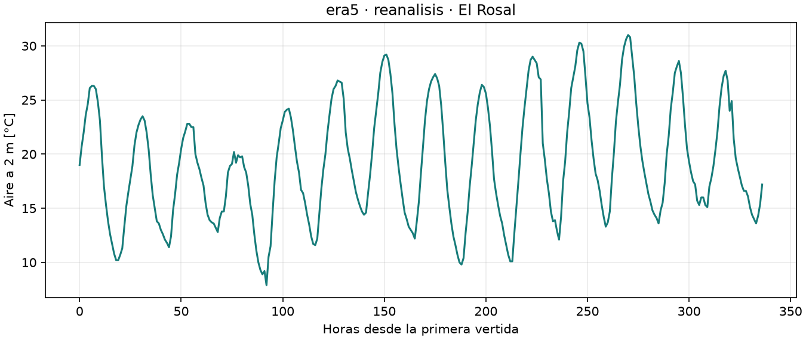
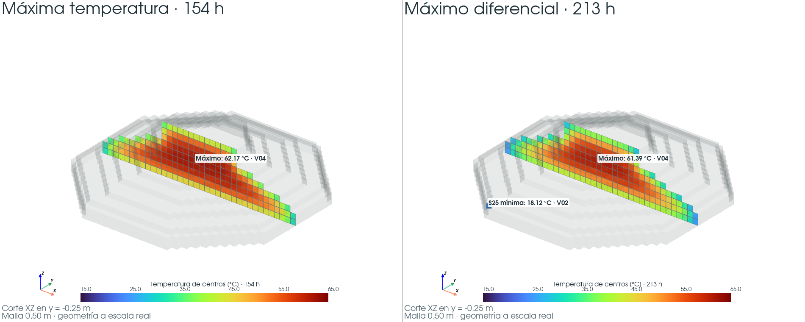
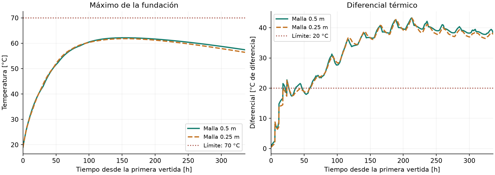

# E12 — Comportamiento térmico de la fundación durante 14 días

**Repositorio:** [Proyecto-2-MCOC](https://github.com/benjagarciag/Proyecto-2-MCOC).
**Commit evaluado:** publicación titulada **Entrega E12**, cuyo SHA completo se
declara en Canvas. Se identifica con `git log -1 --format=%H --grep="^Entrega E12$"`.
Las corridas se ejecutaron el **12-11-2026, 14:17:59 y 14:18:11 UTC**, sobre
`0b295a64847936ebde900e99c2369555ffc37329` con cambios locales registrados en
sus resúmenes. Ese SHA base no identifica por sí solo esta versión completa.

**Resultado principal:** el escenario queda bajo **70 °C**, pero supera el
diferencial permitido de **20 °C**. Por tanto, **el plan no satisface ambos
criterios docentes en esta simulación determinista**.

## 1. Clima utilizado y período de estudio

Se estudia El Rosal, Los Ángeles, en **−37,277929; −72,368271**, durante
**336 h desde la primera vertida**. El calendario hipotético va del
**27-11-2026 a las 10:00 al 11-12-2026 a las 10:00**, hora de Chile;
no corresponde a una fecha de obra aprobada.

| Archivo conservado | Descarga UTC | Uso en E12 |
| --- | --- | --- |
| [Pronóstico GFS de Open-Meteo](../datos/clima/forecasts/20261110T190042897941Z_44b1a950.json) | 10-11-2026, 19:00:42 | Termina el 25 de noviembre UTC: cubre **0 de las 336 h** del escenario. |
| [Reanálisis ERA5 de Open-Meteo](../datos/clima/reanalisis/era5_2025-11-27_2025-12-11_20261110T204052478858Z.json) | 10-11-2026, 20:40:52 | Aporta todo el período mediante un bloque histórico de 2025. |

Se asignaron por hora relativa los datos del **27-11-2025 10:00 al
11-12-2025 10:00**, con 337 marcas e interpolación lineal. No se empalmó una
cola: todo el escenario es histórico. Esto permite estudiar el modelo, pero
**no predice el clima de noviembre de 2026**. Los archivos incluyen metadata
y sus hashes se conservan en los resúmenes.



*Figura 1. Entrada meteorológica: temperatura del aire a 2 m. Las horas se
cuentan desde la primera colocación; no son la edad de todas las vertidas.*

## 2. Vertidas, materiales y condiciones de borde

La geometría y el calendario provienen del [IFC](../desarrollo/fundacion/fundacion.ifc).
Al colocar una vertida se activan sus celdas y comienza su hidratación;
el hormigón previo conserva su temperatura.

| Vertida | Inicio [h] | Colocación [°C] | Retiro moldaje [h globales] | Retiro aislación [h globales] |
| --- | ---: | ---: | ---: | ---: |
| V01 | 0 | 19 | 72 | 96 |
| V02 | 6 | 18 | 78 | 102 |
| V03 | 12 | 18 | 84 | 108 |
| V04 | 18 | 18 | 90 | 114 |
| V05 | 24 | 18 | 96 | 120 |

Se mantienen k=2 W/(m·K), ρ=2400 kg/m³ y cₚ=900 J/(kg·K).
La fuente directa es **q(a)=900 exp(−a/30) W/m³**, con edad **a en horas**,
integrada exactamente por paso. Son propiedades y fuente didácticas,
sin calibración experimental de M1.

| Capa lateral | Espesor | Conductividad [W/(m·K)] | Resistencia e/k [m²·K/W] |
| --- | ---: | ---: | ---: |
| Madera, referencia AraucoPly | 18 mm | 0,158 | 0,114 |
| Lana de vidrio Aislanglass | 40 mm | 0,042 | 0,952 |

La madera usa una referencia de la familia [AraucoPly, tabla 11](https://arauco.com/aus-nz/wp-content/uploads/sites/16/2018/02/Product-Catalog-Australia-NZ-1.pdf),
pendiente de confirmar para el grado chileno y condiciones de uso. La lana usa
la [ficha Volcán, página 1](https://volcan.cl/wp-content/uploads/2022/05/lana_de_vidrio_ces.pdf);
su montaje temporal exterior todavía requiere justificación.

| Región | Tratamiento térmico |
| --- | --- |
| Laterales expuestos, incluidas caras frente a vertidas futuras | Robin con aire horario y **h=5 W/(m²·K)**. Se suman las resistencias de media celda, capas presentes y convección. |
| Horizontales expuestos | Robin con el mismo aire y h, **sin capas**. |
| Base en z=0 | Conducción a suelo de referencia a **15 °C**, distancia efectiva **0,50 m** y k=**1,2 W/(m·K)**; sin resistencia adicional de contacto. |
| Contactos entre celdas activas | Conducción interna con contacto perfecto. |

Los retiros son supuestos: **72 h de edad para moldaje y 96 h para aislación**.
Se supone soporte independiente para mantener la lana tras desencofrar.
El suelo es un reservorio fijo, no un dominio térmico transitorio.
Viento y radiación están archivados, pero no modifican estas corridas.

## 3. Resultados y lectura de las curvas

El solver propio usa balance cartesiano por celda y Euler explícito, con
paso máximo de **900 s**. La referencia de **0,50 m** tiene 5.140 celdas y
1.344 pasos. Su volumen es **642,50 m³**, frente a **636,78 m³** del IFC.

Se evalúa **ΔT(t)=Tmax,Ω(t)−Tmin,S25(t)** en cada instante. S25 se reconstruye
a 25 mm bajo las caras exteriores; no es el aire ni el mínimo del volumen.
Los dos extremos pueden pertenecer a vertidas distintas.

| Magnitud, malla 0,50 m | Valor [°C] | Tiempo [h] | Resultado frente al límite |
| --- | ---: | ---: | --- |
| Máxima temperatura | **62,167** | **154** | Bajo 70 °C |
| Máximo diferencial | **43,264** | **213** | Supera 20 °C |

| Punto relevante | Vertida | Coordenadas (x; y; z), en metros |
| --- | --- | --- |
| Máxima temperatura a 154 h | V04 | (−0,25; −0,25; 2,25) |
| Máximo del dominio a 213 h: 61,387 °C | V04 | (−0,25; −0,25; 2,25) |
| Mínimo S25 a 213 h: 18,123 °C | V02 | (−3,75; −8,75; 0,975) |


*Figura 2. La sonda interior sigue un punto fijo de V03 y comienza al colocarla,
a las 12 h. Los extremos espaciales pueden cambiar de ubicación. La franja
marca los retiros escalonados; el máximo diferencial aparece después.*



*Figura 3. Capturas PyVista de los VTI actuales: 154 h y 213 h, con la misma
escala de colores. El corte pasa por el máximo; el volumen transparente da
contexto. Los colores representan centros de celdas. El marcador S25 muestra
un valor reconstruido fuera del plano del corte. Cortar la vista no modifica
los bordes físicos. [Captura ampliada del diferencial](../resultados/e12/corte.png).*

## 4. Comparación de mallas y alcance

| Malla | Volumen [m³] | Tmax [°C] / tiempo [h] | ΔTmax [°C] / tiempo [h] |
| --- | ---: | --- | --- |
| 0,50 m | 642,500 | 62,167 / 154 | 43,264 / 213 |
| 0,25 m | 633,375 | 61,821 / 154,5 | 43,156 / 213 |



*Figura 4. Ambas resoluciones llevan a la misma conclusión de incumplimiento
del diferencial. La cercanía de curvas no valida por sí sola la malla.*

El error global de volumen es +0,90 % en 0,50 m y −0,53 % en 0,25 m.
Sin embargo, el error por vertida alcanza 37,76 % y 16,03 %, respectivamente.
El máximo cambia de V04 a V03 al refinar. Las ubicaciones finas y S25 siguen
siendo estimaciones sobre superficies escalonadas; no se declara convergencia.

## 5. Conclusión y evidencia reproducible

**El diferencial controla el resultado.** El interior acumula calor de
hidratación mientras las zonas exteriores lo disipan. A las 213 h todavía
hay hormigón a 61,39 °C y un mínimo S25 cercano a 18,12 °C. La máxima
temperatura ocurre antes: no basta con verificar solo su valor.

Toda la aislación ya fue retirada a las 120 h y los horizontales nunca la
tuvieron. Conviene estudiar permanencia y cobertura de la protección;
estas corridas no aíslan causalmente el efecto de cada medida. Cambiar solo
de 40 a 50 mm redujo el diferencial apenas 0,031 °C en la
[comparación guardada](../resultados/e12/comparacion_aislacion/malla_050/comparacion.md),
sin satisfacer el límite. Se conserva 40 mm como referencia de estudio.

No se concluye cumplimiento de obra, ausencia de grietas ni probabilidades
de falla. El escenario histórico, los materiales y el montaje requieren
validación adicional. El residuo energético de la referencia es
**1,34×10⁻⁵ J**, frente a **62,45 GJ** liberados por hidratación: indica
cierre numérico del balance, no validación física.

[HTML interactivo](../resultados/e12/visualizador.html) ·
[Resumen 0,50 m](../resultados/e12/resumen.json) ·
[Resumen 0,25 m](../resultados/e12/malla_025/resumen.json) ·
[VTI del pico](../resultados/e12/pico.vti) ·
[VTI del diferencial](../resultados/e12/diferencial.vti) ·
[Entradas](../casos/semana4/parametros.json).

Desde la raíz, con las [dependencias preparadas](../entregas/E11/README.md):

```powershell
python -X utf8 -B casos/semana4/ejecutar.py e12
python -X utf8 -B casos/semana4/ver_3d.py resultados/e12/diferencial.vti
```

Las figuras se regeneran desde resultados guardados, sin recalcular física:
`python -X utf8 -B casos/semana4/figuras_reporte_e12.py`.
