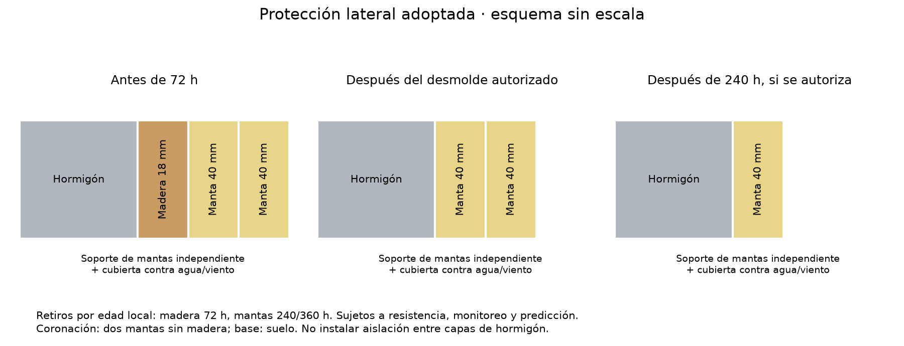

# Propuesta física y constructiva adoptada — Benjamín

> **Revisión de radiación posterior:** ver [prueba de sensibilidad](SENSIBILIDAD_RADIACION.md).
> Los parámetros se mantuvieron para compararlos. Los 24 pares nominales
> cumplen a 14 días en malla 0,40 m; después aparecen excedencias del diferencial,
> particularmente al quedar expuestas las caras tras retirar las mantas.
> Los retiros propuestos no equivalen a liberación térmica validada para todo
> el seguimiento con exposición solar. No se cambió aquí el procedimiento.

Fecha: 18-11-2026. Decisión del usuario: conservar nuestros **nueve circuitos**.
Este documento sustituye los pendientes B1–B7 y las notas anteriores de
encendido por edad, tres sectores, caudal total 43 L/min y apagado a 432 h.
No modifica el IFC de práctica ni las simulaciones históricas. El cierre
corresponde al alcance docente idealizado, no a ingeniería de detalle de obra.

## 1. Configuración común y refrigeración

Una colocación continua de 636,775 m³, dos frentes de 30 m³/h, total 60 m³/h,
a 12 °C en recepción y activación. Duración física10,613 h para toda la
fundación. Los cinco objetos IFC conservan su identidad geométrica: no
se exige esperar resistencia entre ellos. Las once capas físicas tienen
espesor máximo0,40 m, con última0,30 m. Se mantiene el catálogo completo
de ocho fuentes y tres climas; ninguna curva favorable se selecciona como
mezcla comercial. El caudal disponible es un supuesto docente autorizado,
no capacidad local contratada.

Se adoptan nueve ramales metálicos paralelos C01–C09, diámetro interior
de cálculo25 mm, separados aproximadamente 1 m entre ramas principales,
según [esquema y capas](CIRCUITOS_Y_CAPAS_ADOPTADOS.md). Sus cotas son
0,5/1,5/2,5/3,8 m, con 3/3/2/1 circuitos. Longitud interna total 638,85 m;
no incluye acometidas ni colectores. Cada ramal abierto conduce18 L/min;
el sistema circula162 L/min nominales, derivando por bypass el caudal de
ramales cerrados. Se equilibran ramales mediante válvulas y caudalímetros;
los ramales no se conectan en serie. Antes de colocar se fijan a soportes,
se identifican extremos y se comprueba estanqueidad y continuidad con un
procedimiento compatible con el fabricante. No se fija presión de prueba
sin clase comercial de tubo y accesorios.

**Ley adoptada:** agua idealmente uniforme a 18 °C a lo largo de cada
ramal; U equivalente5 W/(m³ K) y extracción conjunta limitada a 15 kW.
El tope no es una potencia constante ni el consumo eléctrico del equipo.
El cálculo no resuelve resistencia de pared ni calentamiento axial del agua.

Una central de agua acondicionada con depósito, bomba, colectores,
bypass y regulación es el esquema de suministro térmico propuesto. Se
especifica capacidad útil de extracción disponible de al menos15 kW a
la condición18 °C, más ganancias de tuberías, depósito y ambiente a
evaluar para seleccionar equipo. No se elige marca, potencia eléctrica
ni altura de bomba sin pérdidas de carga. Se contempla bomba de reserva
y alimentación de respaldo como recursos de contingencia del plan.

Comprobación energética informativa:162 L/min≈2,7 kg/s. A15 kW,
P/(ṁ·cp_agua)≈1,33 K usando cp_agua4180 J/(kg K). Si solo abre un ramal,
18 L/min y 15 kW equivaldrían a 11,96 K. Estos valores muestran que **agua
uniforme a 18 °C es una idealización**, no predicción de retorno. No se
fijan18 °C de entrada y salida junto con extracción finita como balance
hidráulico real. La hipótesis ideal se conserva por autorización del usuario;
para una instalación real hace falta resolver transferencia y pérdidas.

### Regla operativa congelada

1. Un ramal permanece cerrado hasta terminar la capa que cubre todos sus tubos.
2. Abre si toda la temperatura del hormigón monitoreada junto a sus tramos es≥19 °C.
3. Cierra si algún tramo llega a≤18 °C, falta cobertura o se pierde una medición válida.
4. Entre18 y 19 °C conserva su estado. Puede reabrir cuando todos recuperan≥19 °C.
5. El conjunto nunca extrae más de 15 kW en el modelo. No hay corte global a 432 h.

La cobertura geométrica habilita aproximadamente a 3,579/6,861/9,500/10,421 h
los grupos3/3/2/1, respectivamente. Son instantes mínimos geométricos,
no aperturas programadas: la hidratación debe alcanzar también el umbral.
La decisión se evalúa cada paso numérico; en obra se propone supervisión
automática cada minuto. La simulación controla centros de celdas cercanos
al recorrido, no temperatura exacta en la pared.

### Obtención de 12 °C en recepción

Se adopta preenfriamiento en planta de agua y agregados, sombra y despacho
coordinado. El uso de hielo como sustituto de parte del agua solo se admite
con dosificación y fusión controladas; no añadir agua libre en obra para
corregir temperatura. Estas técnicas están descritas por [ACI](https://www.concrete.org/frequentlyaskedquestions.aspx?faqid=892).
La técnica concreta depende de temperatura de materiales y transporte.

Se mide temperatura en **cada camión al descargar**, registrando hora,
volumen y lote. Los12 °C son condición exacta de la simulación: una
desviación de recepción se registra y se evalúa con el modelo antes de
atribuirle los resultados nominales. No se promete una tolerancia térmica
no simulada. Si la planta no sostiene temperatura y caudal, cambia el plan.
La carga sensible de preenfriamiento se estima como
ρ·cp·60/3600·(T_sin_enfriar−12)=42,22·(T_sin_enfriar−12) kW térmicos;
por ejemplo, desde 20 °C son 337,7 kW, separados de los15 kW embebidos.
No es potencia eléctrica ni dimensionamiento completo de planta.

## 2. Procedimiento de colocación y continuidad

Se suponen tubos fijados, armaduras, moldajes y equipos listos al inicio
común de colocación. El montaje previo no está cronometrado en este
modelo; si retrasa el inicio respecto de t₀, esa espera debe añadirse aD.

Se divide cada sección horizontal en dos mitades de área aproximadamente
igual, servidas simultáneamente por sendos frentes. En cada mitad se
colocan bandas sucesivas con recorrido repetido en cada capa, coordinando
el encuentro central y los cambios de sección. Se completa el nivel antes
de elevar el conjunto; no se llena una mitad en toda su altura primero.
Volúmenes y horarios por capa están en
`resultados/diseno_circuitos_colocacion/esquema.json`.

La capa inferior mayor requiere107,364 m³/60=1,7894 h≈107,4 min.
Se adopta como **requisito de suministro del plan**, a demostrar con la
mezcla a temperatura real, una ventana local de unión y consolidación
de al menos150 min desde la colocación de la capa inferior. No se deduce
ese valor de un tiempo de fraguado bibliográfico. Mantener el mismo orden
de recorrido busca que el retorno local sea comparable a un ciclo de capa;
el registro por bandas debe comprobar el peor intervalo real. El margen
nominal de 150−107,4≈42,6 min no autoriza interrupciones deliberadas.

Cada frente dispone de cuadrilla de distribución y consolidación, vibrador
operativo y uno de respaldo; se comprueba alcance entre armaduras y tubos.
Se vibra con patrón sistemático y penetración en la capa anterior mientras
sea consolidable, sin usar vibrador para transportar hormigón lateralmente.
Se verifica especialmente zona inclinada, anclajes y encuentro pedestal/base.
[DNV](https://www.dnv.com/article/foundation-concrete-voids-229998/)
documenta estas dificultades y la colocación por capas en fundaciones eólicas.

El encargado registra inicio y fin de bandas, último recubrimiento y
caudal real. Tras15 min de interrupción se activa abastecimiento/equipo
de reserva y se recalcula el plazo local; antes de agotar la ventana
validada se requiere decisión del responsable técnico. Si el hormigón
inferior perdió aptitud de unión, no se afirma continuidad: se trata como
desviación/junta que exige revisión estructural y nueva secuencia térmica.
El tiempo de 150 min es una condición propuesta de aceptación, **no un ensayo
de trabajabilidad ya realizado**. El solver actual activa capas completas;
no resuelve el movimiento horizontal de las bandas ni predice juntas frías.

## 3. Protección, soporte y retiro

Se mantiene excavación abierta, base en contacto con borde térmico de
suelo y laterales sin relleno durante el estudio. No se dimensiona la
excavación ni su sostenimiento. Las caras entre capas sucesivas no llevan
madera ni mantas intercaladas. Solo se protegen caras exteriores o la
superficie superior temporalmente expuesta hasta colocar la siguiente capa.

| Ubicación | Montaje adoptado | Referencia de retiro por edad local |
| --- | --- | --- |
| Laterales exteriores | Hormigón → madera18 mm → dos mantas40 mm → protección exterior contra lluvia y viento | Madera72 h; manta exterior240 h; manta restante360 h |
| Superficie superior expuesta | Curado compatible → dos mantas40 mm protegidas del agua, sin cargas puntuales sobre hormigón fresco | Manta exterior240 h; restante360 h |
| Base | Contacto equivalente con suelo; sin mantas | No aplica |

La madera usa k0,158 W/(m K), cada manta k0,042. Se disponen juntas
escalonadas y fijaciones contra viento, evitando huecos; no se añade
resistencia térmica calculada a película de curado/protección exterior.
Se evita saturar la lana; manta húmeda o dañada se sustituye por equivalente.
Tras retirar madera, bastidores o sujeciones independientes mantienen
las mantas continuas. Se trabaja por paños pequeños, con protección
alternativa temporal, evitando exposición general durante el cambio.

**72 h no acredita resistencia de desmolde.** El retiro exige autorización
del responsable estructural con evidencia de resistencia y sin dañar
caras. Si no se obtiene, se conserva el moldaje y se reevalúa su efecto
térmico. No se inventa resistencia mínima sin diseño estructural.

Los retiros240/360 h son el calendario nominal simulado, **no una orden
automática de obra**. No adelantar basándose únicamente en queΔT actual
es pequeño. Para retirar: sensores válidos, ΔT observado≤18 K, sin
alarma de temperatura, y proyección actualizada de las próximas48 h con
la etapa de retiro propuesta que mantenga Tmax≤70 °C yΔT≤20 K bajo los
escenarios vigentes. Se añade revisión del contraste núcleo–ambiente y
del enfriamiento nocturno. El umbral18 K es margen operativo propuesto,
no límite docente adicional ni garantía por sí solo. Si no se cumplen
las condiciones, se difiere retiro y se recalcula; esa trayectoria diferida
no se atribuye a la matriz nominal. Se mantiene vigilancia al menos24 h
después de cada retiro, recolocando protección si el diferencial crece.

El estudio de Luis sobre retiros es antecedente de otra configuración;
no sustituye nuestra comprobación. [PCA, EB547](https://www.cement.org/wp-content/uploads/2024/08/EB547.pdf)
respalda coordinar aislación y monitoreo para evitar enfriamiento superficial
brusco; las edades y umbrales anteriores son decisiones del proyecto.

## 4. Instrumentación y responsabilidades

Se adopta medición automática a 1 min durante colocación, aperturas/cierres,
retiros y alarmas; archivo a≤5 min durante todo el control y sin promediar
extremos para clasificar. Se conservan datos brutos, sincronización horaria,
calibraciones, fallas y cambios de válvulas. La frecuencia supera el mínimo
de registro horario discutido por [PCA](https://www.cement.org/wp-content/uploads/2024/08/EB547.pdf).

| Conjunto | Ubicación/alcance propuesto | Objetivo |
| --- | --- | --- |
| Núcleo y pedestal | Pares redundantes cerca de(0;0;2,6) y(0;0,8;4,2) m, con ajuste a armadura y superficie real IFC | Capturar zonas calientes y máximos cambiantes |
| S25 | Pares a 25 mm hacia el interior de base, laterales y coronación; priorizar borde inclinado próximo a(−3,6;−8,8;1,175) y base próxima a(−3,6;−8,8;0,025) m | Detectar enfriamiento exterior;25 mm es criterio del curso |
| Contorno adicional | Caras opuestas, esquinas, encuentro pedestal/base y zonas de sombra/viento | Reducir riesgo de no observar el mínimo global |
| Cada circuito | Línea de sensado distribuido junto al recorrido C01–C09, resolución espacial objetivo≤0,5 m, más termómetro independiente en punto desfavorable | Aplicar la mínima de todos los tramos instrumentados |
| Agua | Temperatura y caudal en cada ramal, entrada/retorno de colector; presión diferencial y posición de válvula | Detectar bloqueo, pérdida de regulación y caudal |
| Ambiente | Temperatura protegida de radiación y viento representativo a 2 m | Contrastar condiciones de borde |

Las coordenadas son objetivos del modelo, no planos de perforación:
S25 en superficie inclinada se instala a 25 mm **según normal real**, no
copiando sin revisión una cara de voxel. Se fija antes de hormigonar y
se documenta posición final. Dos sensores vecinos no deben compartir
un único punto de falla en adquisición/cableado.

La precisión total objetivo es±0,2 °C para concretos/agua, verificada
antes y después. Es especificación propuesta, no equipo comprado. Para
control conservador de obra se aplican umbrales a la mínima inferior
corregida por error, conservando el modelo nominal19/18 °C como referencia;
su efecto sobre tiempos necesita actualización si se usa para predecir.
La medición distribuida reduce puntos ciegos pero no mide un continuo
matemático ni certifica Tmax global. Sensores puntuales solos no comprueban
la condición «todos los tramos». ElΔT observado es estimación instrumental;
el criterio final usa también el campo del modelo y su incertidumbre.

Encargado de colocación: suministro, bandas, temperatura y vibrado.
Encargado térmico: adquisición, válvulas, alarmas y aprobación térmica de
retiros. Responsable técnico de obra: decisiones de desmolde, desviaciones
y continuidad estructural. Para la entrega Benjamín documenta el plan,
Luis verifica el algoritmo y Matías incorpora escenarios y evidencia;
estos nombres no equivalen a designaciones profesionales en una obra real.

## 5. Alarmas, contingencias y término del control

| Evento | Disparador operativo propuesto | Respuesta |
| --- | --- | --- |
| Advertencia térmica | Tmax observada≥65 °C oΔT observado≥18 K; tendencia que anticipe cruce | Revisar sensores y clima; suspender retiros; actualizar predicción y asegurar frío disponible |
| Intervención | Tmax≥68 °C oΔT≥19 K | Aviso inmediato al responsable; conservar/reponer protección si superficie enfría; operar solo circuitos admisibles; recalcular sin superar15 kW ni cambiar agua silenciosamente |
| Límite docente | Tmax>70 °C oΔT>20 K | Registrar excedencia, no declarar cumplimiento; revisar modelo/plan y evaluación técnica |
| Pérdida de frío o energía | Alarma de bomba, falta de caudal o agua fuera de condición18 °C | Activar respaldo; no retirar mantas; registrar duración y simular período sin extracción; no atribuirle la matriz nominal |
| Dato de circuito perdido | Falta de temperatura válida en algún tramo instrumentado | Cerrar ese ramal y derivar a bypass, reparar y actualizar cálculo; evitar asumir que sigue cumpliendo |
| Sensor aislado anómalo | Incoherencia con redundante y datos vecinos | Conservar alarma hasta diagnóstico; no eliminar extremo solo por ser desfavorable |
| Hormigón distinto del supuesto | Temperatura, consistencia, caudal o recubrimiento fuera del plan | Registrar por lote/banda, corregir suministro y recalcular activaciones/fuente si procede; no añadir agua para recuperar flujo |
| Manta retirada/húmeda o clima adverso | Inspección y datos de superficie/ambiente | Restituir aislamiento, asegurar contra viento y actualizar bordes; no enfriar superficies bruscamente |

Los umbrales65/68 y 18/19 son anticipación propuesta, no resultados de
optimización ni reglas normativas. Cualquier cambio correctivo de
temperatura de agua, potencia, colocación o protección exige nueva
predicción: no se garantiza que toda acción reduzca ambos indicadores.

Se reportan **14 días desde primera colocación** como horizonte exigido,
con seguimiento diagnóstico adicional a600–672h, que registra excedencias con radiación. No se apaga ni desmonta
por cumplir el día14 o432 h. Para terminar control activo se requiere:
revisión técnica, ausencia de demanda de reapertura durante24 h, datos
válidos, protecciones finales retirables y proyección de al menos48 h sin
enfriamiento que conserve límites bajo clima previsto y escenarios.
Ese ensayo sin frío es condición de liberación futura, no resultado de
la matriz actual. Hasta satisfacerla se conserva disponibilidad del sistema
y registro. No se asigna una fecha de liberación no calculada.

## Evidencia termica actual con radiacion

La comparacion vigente incluye solar y onda larga. Los cuatro rendimientos60/55/50/45m3/h se evaluaron en24pares por plan,0,40m/300s y336h. La candidata60 tiene24pares finos completos a0,20m/300s: Tmax47,0322C y DeltaT15,7202K. No se registran excedencias en14dias dentro del catalogo. El mayor cambio espacial pareadoDeltaT es1,1746K y el temporal0,0014K en tres pares. Los seis contrastes finos de alternativas son selectivos.

Auditoria de5matrices,129piezas y1161registros aprobada. La zona refrigerable414,016m3 se conserva fisicamente al refinar. Ver [comparacion](COMPARACION_CIRCUITOS_FINAL.md), [ecuaciones](ECUACIONES_MODELO_VIGENTE.md) e [intercambio de tuberias](INTERCAMBIO_TUBERIAS.md). El sumidero no calcula pared ni agua axial y el caudal no calibra Uvol.

El seguimiento con radiacion600-672h registra excedencias despues de14dias. Los retiros72/240/360h son edades nominales condicionadas a resistencia, monitoreo y nueva prediccion. La ultima manta se retira despues del horizonte exigido; no se presenta como liberacion termica acreditada. No hay fecha definitiva de apagado calculada.

Las comparaciones antiguas sin radiacion son antecedentes. La configuracion vigente es [MODELO_VIGENTE.json](MODELO_VIGENTE.json). La temperatura12C y los tiempos siguen como plan externo al IFC.

## Coordinación con Luis y Matías

- Fundamentos de Luis/Matías integrados con sus commits y copias de fuente
  en [INTEGRACION_EQUIPO_CIRCUITOS.md](INTEGRACION_EQUIPO_CIRCUITOS.md).
- Tablas y siete figuras actuales disponibles en `evidencia_f02_radiacion/`:
  cuatro ritmos homogéneos, fuentes/climas, historias, cortes y malla fina.
- La cotaD≥V/60 se alcanza en el escenario adoptado. No se afirma una
  falla térmica de ritmos superiores60: exceden el recurso de la familia.
- El informe y la presentación final corresponden al equipo. El respaldo
  final, SHA y ensayo se excluyeron; este cierre técnico no los declara hechos.
