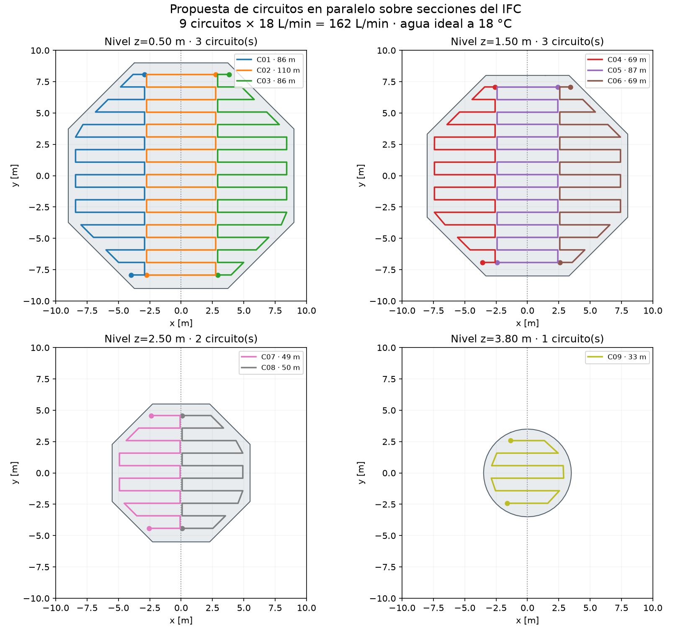
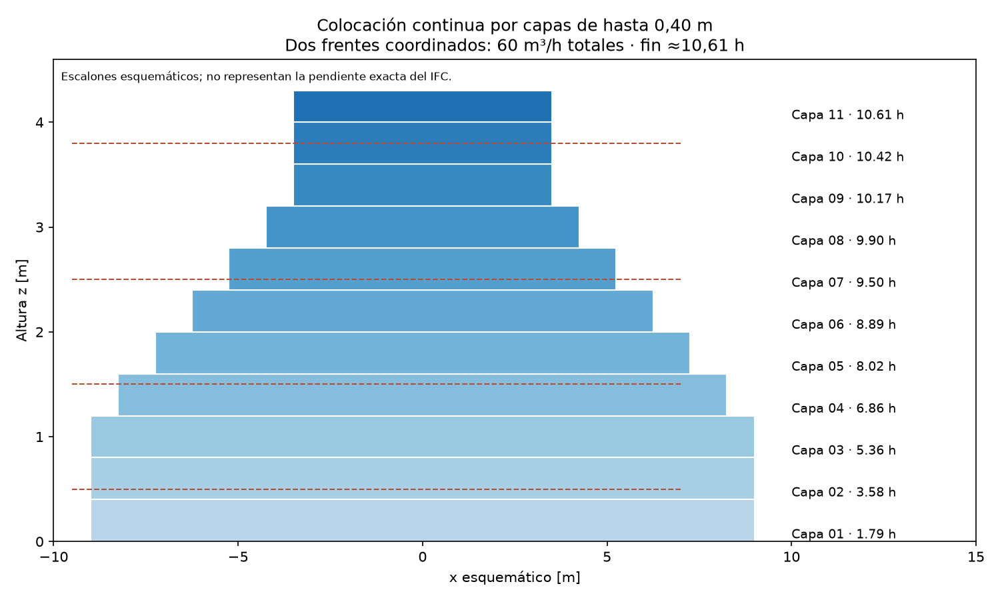

# Propuesta de circuitos y colocación por capas

**Actualización posterior:** la geometría aquí descrita se conserva.
Habilitación, regulación, protección, monitoreo y contingencias quedaron
definidos en [CIERRE_BENJAMIN.md](CIERRE_BENJAMIN.md). La simulación de
nueve circuitos19/18 °C usa cobertura previa y no corte global432 h.
Las frases siguientes de «pendiente» describen la etapa de anteproyecto;
los archivos geométricos originales se conservan por trazabilidad.

Se define a solicitud del usuario un anteproyecto para el ejercicio docente,
para justificar y comprobar después. No es un plano de ejecución ni un
dimensionamiento validado de refrigeración. No se modifica el IFC ni se
trasladan resultados de cumplimiento del sumidero antiguo a estas tuberías.

## Caudal de agua constante adoptado

| Parámetro | Propuesta |
| --- | --- |
| Agua idealizada |18 °C constantes, autorización docente informada por usuario |
| Número de circuitos |9, conectados hidráulicamente en paralelo |
| Caudal por circuito en servicio |18 L/min constantes |
| Caudal total nominal con los9 en servicio |162 L/min=9,72 m³/h |
| Diámetro interior de cálculo |25 mm |
| Material de propuesta |Tubería metálica; espesor/diámetro exterior/clase comercial por seleccionar |
| Velocidad de agua calculada |0,611 m/s |
| Distribución |Colector de alimentación y retorno exteriores, ramales independientes y equilibrados |

El caudal se define desde diámetro y velocidad de circulación:
`q_circuito = velocidad*π*D_interior²/4`, no suponiendo temperatura
de salida23 °C. La referencia USBR EM34 describe velocidades del orden
de0,61 m/s en sus sistemas de enfriamiento de hormigón masivo. Es respaldo
de orden de magnitud, no requisito universal ni dimensionamiento local.

Se deben equilibrar caudales porque las longitudes son distintas. Las
válvulas, colectores, pérdidas de carga, estanque/enfriador y bomba deben
seleccionarse después; el caudal no define por sí solo la altura de bombeo.
162 L/min corresponde a los9 ramales activos. La secuencia de habilitación
queda pendiente por solicitud del usuario; la circulación durante etapas
parciales requerirá gestionar ramales/bypass sin atribuir162 a cada uno.

El balance hídrico agregado daría un aumento medio equivalente de apenas
≈1,33 K si el conjunto retirara15 kW con162 L/min (ρ≈1000, cp≈4180),
lo que solo sirve para evaluar el orden de magnitud de mantener agua fría.
No se fija ese aumento como condición de salida: el cálculo térmico docente
mantiene agua ideal a18 °C. Tampoco demuestra uniformidad de temperatura
en cada circuito ni capacidad de extraer15 kW del hormigón.

## Disposición sobre la geometría real del IFC

Se leyeron los cinco sólidos con IfcOpenShell sin alterar geometría, GUID
ni propiedades. El conjunto mide18×18×4,30 m y se estrecha hacia arriba;
no es una caja maciza de18×18×4,30. Se obtuvieron secciones de sus mallas
para adaptar las serpentinas a cada cota.

| Cota de ejes z desde base | Circuitos | Longitud interior esquemática por circuito |
| --- | --- | --- |
|0,50 m |C01–C03 |86 /110 /86 m |
|1,50 m |C04–C06 |69 /87 /69 m |
|2,50 m |C07–C08 |49 /50 m |
|3,80 m, pedestal |C09 |33 m |

Total interior esquemático≈639 m, sin contar acometidas exteriores,
montantes, colectores ni ajuste de curvas a radios comerciales.
Separación nominal de ramas largas≈1 m; planos inferiores separados1 m,
último plano1,30 m sobre el anterior. Cada circuito recorre una franja
del corte horizontal y conecta a colectores externos, no al circuito vecino.

Se deja margen horizontal nominal de ejes≥0,50 m respecto de la sección.
No equivale a verificar recubrimiento mínimo tridimensional en las caras
inclinadas ni interferencia con barras/pernos. Revisar distancias3D,
fijaciones, cruces, radios de curvatura y recorrido de acometidas antes
de un plano definitivo. Las líneas gráficas con esquinas son esquemas,
no codos que deban fabricarse de esa forma exacta.

Los tubos se instalan y fijan a soportes compatibles con armadura y
recubrimientos, con extremos identificados y accesibles fuera del moldaje.
Comprobar estanqueidad antes de colocar y proteger durante descarga/vibrado.
No requiere alterar la geometría estructural ni introducir juntas nuevas.



## Capas de colocación adoptadas para el procedimiento

Operación continua, dos frentes coordinados a30 m³/h por frente, total60,
colocación12 °C. Capas de espesor **máximo0,40 m**, desde z0 hasta4,30 m:
10 capas0,40 m y última0,30 m. Son11 capas de construcción, no11 nuevas
vertidas con esperas de resistencia. Se preservan las5 divisiones IFC
como identidad de geometría; sus límites no crean automáticamente juntas.

Cada frente sirve una mitad de la sección, coordinando un mismo nivel y
un patrón de avance repetido. Se propone rellenar/vibrar bandas sucesivas
y enlazar en la zona de encuentro, antes de que la capa anterior pierda
aptitud para consolidación conjunta. No acumular toda la altura en una
mitad antes de completar la otra. Recorrido detallado, espesor permitido
por vibrador/armadura y ventana de trabajabilidad deben comprobarse.

La integración de secciones del IFC entre límites de capa reproduce el
volumen636,775 m³ con diferencia<0,00004 m³ en el cálculo geométrico.
Los volúmenes de las primeras capas son≈107,36 m³ cada una; a60 m³/h,
una capa inferior requiere≈1,79 h. No son1,79 h de espera añadida:
se trabaja durante ese intervalo. La última requiere≈0,19 h; fin total
10,613 h. No sumar tiempos de ambos frentes porque trabajan simultáneamente.

**No se ha demostrado** que el intervalo local de recubrimiento sea menor
que el tiempo admisible de la mezcla. La duración global de una capa no
es necesariamente el peor intervalo en cada punto; revisar patrón de avance,
fraguado y compatibilidad de continuidad antes de llamarlo procedimiento
constructivamente validado. Si falla, reducir espesor o modificar recorrido
manteniendo caudal total, y actualizar activaciones sin inventar datos.



## Relación con el solver y pendientes acotados

El caudal de hormigón determina cronograma de activación. El caudal de
agua determina una condición hidráulica de propuesta: son magnitudes
distintas y no deben confundirse. El solver equivalente anterior usa
U5 W/(m³ K), máscara refrigerable366 m³ y tope15 kW; no resuelve explícitamente
los9 tubos ni incorpora162 L/min a esa ley. La red propuesta no calibraU.

Las capas físicas0,40 m no coinciden con estratos de malla0,50 m anteriores.
Para evaluarlas deben adaptarse activaciones/grupos o usarse resolución
que represente esos intervalos, comprobando que no se coloca volumen antes
de tiempo. No etiquetar las corridas antiguas como esta nueva configuración.

Habilitación de circuitos, regulación y apagado quedan para después según
instrucción del usuario; los tiempos antiguos6/432 h no se adoptan de nuevo
automáticamente. La potencia instantánea dependerá de temperatura y
transferencia;15 kW es un tope, no una extracción constante garantizada.

## Referencias para fundamentar después

- [USBR, EM34, p.6 impresa/página13 del PDF](https://www.usbr.gov/tsc/techreferences/hydraulics_lab/pubs/EM/EM34.pdf): ejemplo de tuberías/circulación en hormigón masivo; no se extrapola automáticamente el diseño de presa.
- [PCA, Mass Concrete for Buildings and Bridges, pp.17–18 impresas](https://www.cement.org/wp-content/uploads/2024/08/EB547.pdf): distribución de tubos, orden de separación1 m, fijación y prueba de estanqueidad. Las cotas, cantidad y caudal aquí son elecciones del proyecto.
- [DNV, Foundation concrete voids](https://www.dnv.com/article/foundation-concrete-voids-229998/): colocación por capas y consolidación en fundaciones eólicas;0,40 m se propone dentro del orden de espesor descrito, sin certificar su ejecución local.

## Archivos y reproducción

Configuración editable `casos/sensibilidad_h/circuitos_colocacion.json`.
Geometría de circuitos, volúmenes y cronograma en
`resultados/diseno_circuitos_colocacion/esquema.json`, con huellas de
IFC/configuración/script. Reproduce esquemas sin solver ni modificación IFC:

```powershell
.\.venv\Scripts\python.exe -X utf8 -B casos/sensibilidad_h/definir_circuitos_colocacion.py
```

Estado: propuesta definida y consistencia geométrica/aritmética comprobada.
No se ejecutaron simulaciones térmicas ni se certificó hidráulica o estructura.
