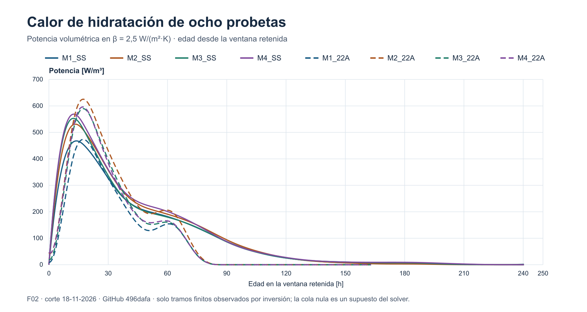

# M1 · Ocho curvas de hidratación

**Proyecto 2 MCOC, Grupo 6 · Matías Stierling · corte 18-11-2026**
Insumos fijados a [`496dafa`](https://github.com/benjagarciag/Proyecto-2-MCOC/commit/496dafa470afc9815d0451ee412d0a3e1fbb8dcd).

La hidratación libera calor por unidad de volumen de hormigón. Cada columna es una estimación de esa potencia interna en función de la edad de la probeta. El adjunto y los dos archivos con `source_terms.txt` de GitHub coinciden byte por byte. SHA-256 `182b4a500dd02060b89dc452f007a379c7ab6cdc569e67de59a04c00d3497956`. [Original del profesor en GitHub](https://github.com/benjagarciag/Proyecto-2-MCOC/blob/496dafa470afc9815d0451ee412d0a3e1fbb8dcd/datos/hidratacion/source_terms.txt) · [Rastro local](insumos/procedencia.json)

## Resultados reproducidos

| Curva | Campaña | Potencia máxima [W/m³] | Edad al máximo [h] | Duración [h] | Integral [MJ/m³] | Total publicado [MJ/m³] | Calidad |
|---|---|---:|---:|---:|---:|---:|---|
| M1_SS | SS | 467,75 | 13,833 | 240,333 | 88,148355 | 88,1 | Ajuste ~0,1–0,2 K. Último valor 1,57 W/m³. |
| M2_SS | SS | 531,11 | 13,333 | 240,333 | 95,715228 | 95,7 | Ajuste ~0,1–0,2 K. |
| M3_SS | SS | 553,01 | 12,333 | 240,333 | 94,149018 | 94,1 | Ajuste ~0,1–0,2 K. |
| M4_SS | SS | 568,94 | 12,500 | 240,333 | 100,166118 | 100,2 | Ajuste ~0,1–0,2 K. |
| M1_22A | 22A | 473,38 | 17,333 | 163,000 | 61,212021 | 61,2 | Menor confianza, RMSE ~0,4 K. |
| M2_22A | 22A | 625,29 | 17,333 | 163,000 | 82,446225 | 82,4 | Menor confianza, RMSE ~0,4 K. |
| M3_22A | 22A | 589,70 | 17,333 | 163,000 | 73,288830 | 73,3 | Menor confianza, RMSE ~0,4 K. |
| M4_22A | 22A | 596,08 | 17,167 | 163,000 | 73,628343 | 73,6 | Menor confianza, RMSE ~0,4 K. |

SS está rotulada **13–20 de abril de 2025** y tiene 1.443 valores finitos por curva. 22A está rotulada **22 de abril de 2025** y tiene 979. Las fechas identifican las campañas según el encabezado. La duración se tomó de las series y su paso, sin inferir fechas de cierre. En 22A un solo sensor ambiente no representa bien la respuesta diaria de las probetas. El RMSE citado corresponde al ajuste de temperaturas del ensayo. La dosificación de cada probeta y la posible relación entre registros siguen por confirmar. [Tabla de cálculo](tablas/M1_curvas.csv) · [Consultas docentes registradas](https://github.com/benjagarciag/Proyecto-2-MCOC/blob/496dafa470afc9815d0451ee412d0a3e1fbb8dcd/Enunciados%20e%20Instrucciones/Dudas_profesor_pre_evaluacion.txt)

## Ventana, inversión y uso en el cálculo

1. **Edad e integración.** La primera fila corresponde al inicio de la ventana retenida, **dos horas después de comenzar el registro original**. Se usa como edad cero del modelo. El paso es exactamente 600 s. Los decimales impresos en horas son redondeos. Se comprobó que los valores finitos son continuos desde la primera fila y que los `NaN` de 22A aparecen solo después del final. Cada intervalo aporta (300(Q_i+Q_{i+1})$ J/m³ por el trapecio. Los ocho acumulados coinciden punto a punto con los CSV de GitHub dentro de 1 microjulio/m³ y la mayor diferencia frente al total impreso es 0,049018 MJ/m³, compatible con redondear a un decimal.
2. **Inversión térmica.** Se estimó el calor interno a partir de las temperaturas medidas y de un balance axisimétrico por volúmenes finitos. El encabezado indica spline cúbico con 16 funciones base, penalización de segundas diferencias 0,05 y corrección de offset por sensor. La probeta es cilíndrica, de radio 0,0375 m y altura 0,15 m. Se usaron ρ = 2.476 kg/m³ y (c_p=1.023$ J/(kg·K), con contenido de cemento de referencia de 350,77 kg/m³. El ajuste de temperaturas de la probeta y su extrapolación a la fundación son dos etapas distintas.
3. **Efecto de beta.** β representa la conductancia de borde adoptada en las caras de la probeta, en W/(m²·K). Al aumentar β se atribuye más intercambio al borde y la inversión necesita más energía interna para reproducir las mediciones. Por ejemplo, M4_SS pasa de **84,3** a **100,2** y **120,1 MJ/m³** al usar β = 2,1 / 2,5 / 3,0. Estos totales alternativos vienen del encabezado. Las ocho series adjuntas corresponden a β = 2,5. El parámetro de la probeta y el coeficiente (h$ horario de la fundación tienen funciones distintas.
4. **En el solver.** Para una vertida activada a (t_v$, la edad en un instante (t$ es (t-t_v$. El solver interpola linealmente el acumulado y toma la diferencia de energía entre las dos edades del paso. La multiplica por el volumen de la celda y la incorpora al balance. Antes de activar una vertida sus celdas quedan fuera del dominio térmico. Después de la última muestra el acumulado queda constante, equivalente a fuente nula en la cola. Esta aproximación conserva la energía del tramo disponible, pero no reconstruye las primeras dos horas ni el calor posterior al último dato.

[Conversión a acumulado](https://github.com/benjagarciag/Proyecto-2-MCOC/blob/496dafa470afc9815d0451ee412d0a3e1fbb8dcd/casos/incertidumbre/preparar_fuentes.py) · [Interpolación por edad](https://github.com/benjagarciag/Proyecto-2-MCOC/blob/496dafa470afc9815d0451ee412d0a3e1fbb8dcd/desarrollo/mcplan/hidratacion_tabular.py) · [Balance de la fundación](https://github.com/benjagarciag/Proyecto-2-MCOC/blob/496dafa470afc9815d0451ee412d0a3e1fbb8dcd/desarrollo/mcplan/termica_fundacion.py)

**Para defender.** Se verificó matemáticamente la conversión y se identificaron los límites de calidad. Hasta aclarar la correspondencia de dosificaciones y la independencia de los registros, las ocho curvas representan ocho escenarios de modelo. La sensibilidad solo SS de M4 permite mostrar qué cambia si se excluye provisionalmente la campaña de menor confianza por una razón explícita.
