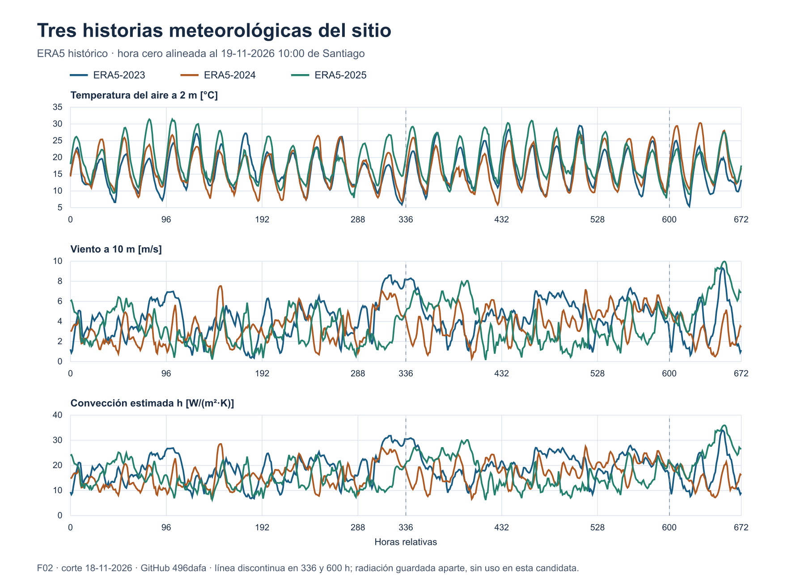
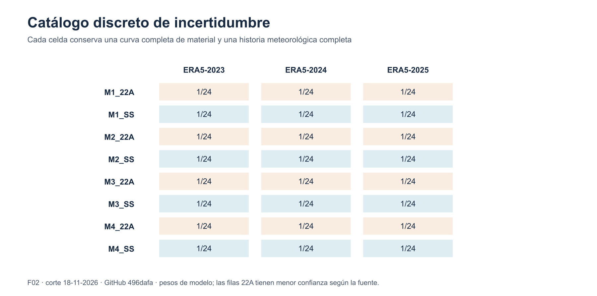

# M2 · Meteorología y catálogo de 24 escenarios

**Proyecto 2 MCOC, Grupo 6 · Matías Stierling · corte 18-11-2026 · `496dafa`**

## Bloques usados

Son historias completas de **reálisis ERA5 histórico** obtenidas con **Open-Meteo Historical Weather API** para Parque Eólico El Rosal, cerca de Los Ángeles, Biobío. El punto solicitado fue −37,277929°, −72,368271°. Los tres archivos devolvieron −37,25°, −72,25° y 121 m. Las variables son aire a 2 m [°C], viento a 10 m [m/s] y radiación de onda corta [W/m²]. Guardamos las tres. En la candidata se usa aire y la convección que se calcula del viento. La radiación quedó fuera del balance de esa configuración. [Origen y configuración del grupo](https://github.com/benjagarciag/Proyecto-2-MCOC/blob/496dafa470afc9815d0451ee412d0a3e1fbb8dcd/casos/incertidumbre/parametros.json) · [Adaptación por viento](https://github.com/benjagarciag/Proyecto-2-MCOC/blob/496dafa470afc9815d0451ee412d0a3e1fbb8dcd/casos/sensibilidad_h/VIENTO.md)

| Historia | Archivo en `datos/clima/reanalisis/` | Rango UTC del archivo | Descarga UTC (17-11-2026) |
|---|---|---|---|
| ERA5-2023 | `era5_2023-11-19_2023-12-17_20261117T013707875952Z.json` | 19 nov 00:00 a 17 dic 23:00 | 01:37:07,875952 |
| ERA5-2024 | `era5_2024-11-19_2024-12-17_20261117T013706897091Z.json` | 19 nov 00:00 a 17 dic 23:00 | 01:37:06,897091 |
| ERA5-2025 | `era5_2025-11-19_2025-12-17_20261117T013707614450Z.json` | 19 nov 00:00 a 17 dic 23:00 | 01:37:07,614450 |

Cada archivo tiene **696 marcas horarias consecutivas**, sin faltantes en las tres variables. La hora cero del bloque histórico es el **19 de noviembre a las 10:00 de Santiago, equivalente a 13:00 UTC**, en el año de ese bloque. Se aplicó la misma hora relativa al 19-11-2026 10:00 UTC−03. Por eso la hora cero corresponde al índice 13 del archivo. Quedan disponibles marcas desde 0 hasta 682 h, suficientes para las 336 y 600 h informadas y el máximo de extensión configurado de 672 h. La secuencia preserva los ciclos y la coherencia entre variables. Su fecha de descarga en 2026 corresponde a la consulta de un histórico. [Metadatos y huellas](tablas/M2_metadatos_ERA5.csv) · [Series alineadas, 0–672 h](tablas/M2_clima_horario.csv)

Verifiqué las tres huellas SHA-256 contra la matriz de 15 kW, y reproduje la serie de convección horaria publicada con (h=5,7+3,8v_{10}(2/10)^{0,14}$. El perfil de terreno abierto y asumir un mismo (h$ para las caras expuestas introducen incertidumbre. En la defensa conviene indicar que un episodio frío o ventoso puede aumentar la diferencia entre núcleo y superficie aunque enfríe el conjunto.

## Pesos y uso de la tabla

| Componente | Regla publicada | Alcance |
|---|---|---|
| Material | Ocho curvas con peso 1/8 cada una. | Igual peso de partida ante la falta de frecuencias sustentadas. Sigue abierta la comparabilidad, en especial 22A. |
| Clima | Tres bloques con peso 1/3 cada uno. | Se prueban tres años completos y coherentes. Su selección no permite asignarles percentiles ni frecuencia futura. |
| Unión material–clima | (w_{mk}=w_m w_k=1/24$. | Independencia asumida entre ambos componentes. Una curva completa y común a las vertidas de cada realización implica variación común del material. |

Hay 24 combinaciones únicas y sus pesos suman uno. El [catálogo CSV](tablas/M2_catalogo_24.csv) usa `curva` y `clima` como clave compuesta compatible con la tabla térmica. Incluye una columna de peso exacto, además del valor numérico. Los pesos se aplican igual a todos los planes.

Cambiar pesos cambia cuánto contribuye una fila fallida. Con doble peso a un año tras normalizar, cada escenario de ese año pesa **6,25 %** y una sola falla allí supera el criterio del 5 %. Si se retiene solo SS por la advertencia de calidad, las 12 filas pesan **8,333 %** cada una. Son pruebas de sensibilidad, no nuevas probabilidades empíricas. Con cero fallas en el catálogo actual, reponderar esas mismas filas no revela el efecto de un clima extremo omitido. Quedan fuera extremos no contenidos en los tres años, variación entre lotes dentro de una vertida, dependencia material–clima, desviaciones de suministro y refrigeración, y errores de representación física y numérica. [Sensibilidad calculada](tablas/M4_sensibilidad.csv)
