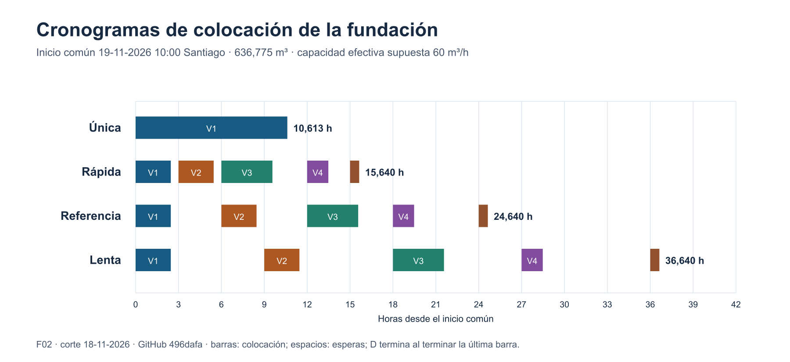

# M3 · Cronogramas y menor tiempo de colocación

**Proyecto 2 MCOC, Grupo 6 · Matías Stierling · versión de cronogramas analizada al 18-11-2026 · `496dafa`**

Este informe conserva la familia de cronogramas publicada en ese corte. La programación final está sujeta al cierre de obra y a la revisión de las matrices por el grupo. [Estado integrado de F02](../README.md)

El inicio común es **19-11-2026 a las 10:00 de Santiago (UTC−03)**. D mide hasta terminar la última colocación e incluye descansos y esperas. La operación continua consume **10,612919878 h** al usar todo el caudal efectivo supuesto. Volumen IFC publicado **636,775192693 m³**. El volumen de la discretización gruesa es 642,5 m³ y pertenece al modelo térmico. Para calcular D se conservó el volumen geométrico IFC. [Volumen y cronogramas originales](https://github.com/benjagarciag/Proyecto-2-MCOC/blob/496dafa470afc9815d0451ee412d0a3e1fbb8dcd/resultados/incertidumbre/curvas_reales/resumen.json)

| Vertida de la partición IFC | Volumen [m³] | Duración [h] a 60 m³/h |
|---|---:|---:|
| 1 | 147,626 | 2,460 |
| 2 | 147,626 | 2,460 |
| 3 | 214,224 | 3,570 |
| 4 | 88,925 | 1,482 |
| 5 | 38,375 | 0,640 |

Los valores de la tabla están redondeados por fila. El CSV conserva la precisión usada en la suma, las horas locales y el fin de cada vaciado.

| Plan | Inicios desde t₀ [h] | Intervalos entre inicios [h] | Esperas reales entre vertidas [h] | Espera total [h] | D [h] |
|---|---|---|---|---:|---:|
| Única | 0 | — | — | 0,000 | 10,613 |
| Rápida | 0 / 3 / 6 / 12 / 15 | 3 / 3 / 6 / 3 | 0,540 / 0,540 / 2,430 / 1,518 | 5,027 | 15,640 |
| Referencia | 0 / 6 / 12 / 18 / 24 | 6 / 6 / 6 / 6 | 3,540 / 3,540 / 2,430 / 4,518 | 14,027 | 24,640 |
| Lenta | 0 / 9 / 18 / 27 / 36 | 9 / 9 / 9 / 9 | 6,540 / 6,540 / 5,430 / 7,518 | 26,027 | 36,640 |

**Intervalo** es próximo inicio menos inicio anterior. **Espera** es próximo inicio menos fin anterior. En la rápida, la tercera empieza a 6 h y acaba a 9,570 h. Empezar la cuarta a 9 h solaparía la colocación. Con la grilla de 3 h, se pasa a 12 h. El intervalo es 6 h y la espera efectiva 2,430 h. Los cuatro cronogramas reproducen D como tiempo colocando más tiempo esperando. [Cronograma por vertida](tablas/M3_cronograma.csv) · [Totales por plan](tablas/M3_planes.csv)

## Familia evaluada, igualdad de recursos y cota

- **Familia.** Una sola operación o cinco partes en el orden IFC. En cinco partes se examinan separaciones nominales de **3, 6 y 9 h**, con paso de inicio de **3 h**, sin solape y con espera mínima configurada de 0 h. Se verificó que cada inicio usa el primer punto de la grilla posterior al máximo entre el fin previo y el inicio previo más el intervalo nominal. Las variantes no exploran otros órdenes, particiones o combinaciones asimétricas de espera. [Configuración y construcción de planes](https://github.com/benjagarciag/Proyecto-2-MCOC/blob/496dafa470afc9815d0451ee412d0a3e1fbb8dcd/casos/incertidumbre/ejecutar.py)
- **Recursos comunes de la familia nueva.** Geometría final, volumen, origen horario, 60 m³/h totales y 12 °C uniformes. El tope de extracción es 15 kW, con la misma ley equivalente, encendido desde 6 h de edad y apagado global en 432 h. Mantener iguales las fuentes, los climas, los pesos, los criterios, la convección horaria y las condiciones acordadas de suelo y protección. Los cuatro planes están configurados y solo la única tiene matriz publicada a la fecha de corte. [Configuraciones](https://github.com/benjagarciag/Proyecto-2-MCOC/blob/496dafa470afc9815d0451ee412d0a3e1fbb8dcd/casos/sensibilidad_h/colocacion_12c.json) · [Estado integrado](https://github.com/benjagarciag/Proyecto-2-MCOC/blob/496dafa470afc9815d0451ee412d0a3e1fbb8dcd/entregas/F02/README.md)
- **Cota física.** A lo sumo entran 60 m³ por hora. Para colocar el volumen total se requiere `60 × D ≥ 636,775192693`, luego **D ≥ 10,612919878 h**. La única alcanza esa cota si sostiene el caudal sin interrupción. Su factibilidad térmica debe confirmarse con la activación y resolución pertinentes, y la factibilidad constructiva debe cerrarse. Si se cumplen ambas, el argumento de caudal excluye un plan más rápido bajo esa capacidad total. Si la única pierde factibilidad, queda por identificar el menor D factible entre alternativas comparables. El estudio no prueba optimalidad fuera de los recursos y supuestos declarados.

## Qué debe confirmar Benjamín

Capacidad efectiva y sostenida considerando planta, camiones, bombeo, descarga y vibrado. Temperatura de 12 °C compatible con ese ritmo. Posibilidad de ejecutar sin juntas frías o con interrupciones controladas. Viabilidad del circuito, momento real de encendido, capacidad útil y continuidad hasta el apagado. Esperas mínimas, accesos, protecciones, restricciones entre etapas y contingencias de suministro. Luis debe trasladar las reglas confirmadas al contraste de activación y a las matrices. [Reparto B1–B7 y L1–L5](https://github.com/benjagarciag/Proyecto-2-MCOC/blob/496dafa470afc9815d0451ee412d0a3e1fbb8dcd/entregas/F02/PENDIENTES_EQUIPO.md)
