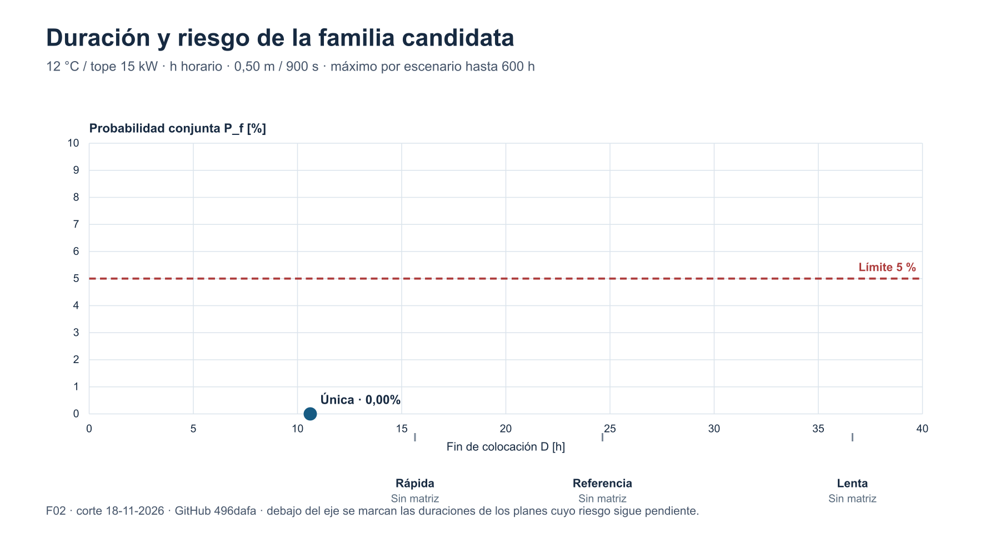
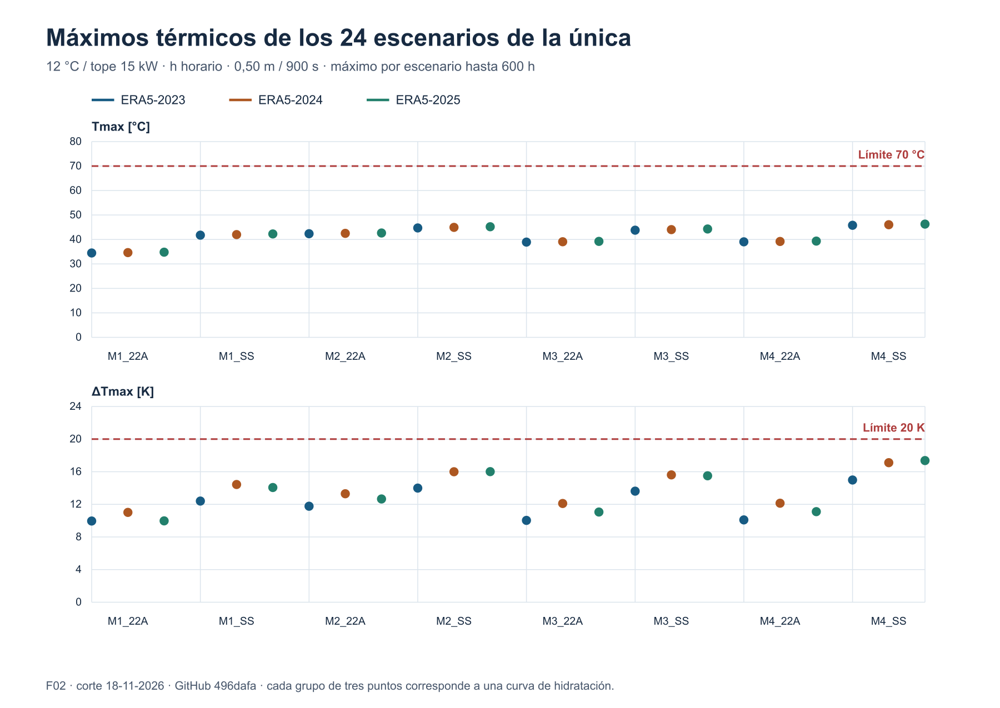
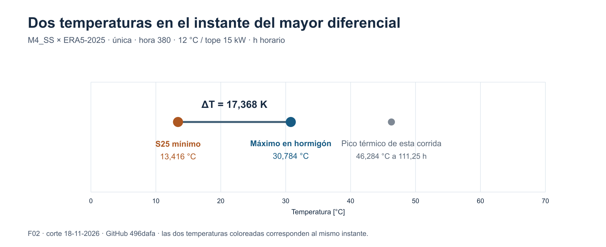

# M4 · Evaluación probabilística de las matrices publicadas

**Proyecto 2 MCOC, Grupo 6 · Matías Stierling · corte 18-11-2026 · `496dafa`**

## Comparación de la familia candidata

| Plan | D [h] | Tmax [°C] | ΔTmax [K] | P_T | P_Δ | P_f | Cumple |
|---|---:|---:|---:|---:|---:|---:|---|
| Única | 10,612920 | 46,284298 | 17,368140 | 0 % | 0 % | 0 % | Sí, en esta resolución y modelo |
| Rápida | 15,639578 | — | — | — | — | — | Pendiente de matriz |
| Referencia | 24,639578 | — | — | — | — | — | Pendiente de matriz |
| Lenta | 36,639578 | — | — | — | — | — | Pendiente de matriz |

**Condición del cálculo publicado:** 12 °C uniformes, (h$ horario, (k=2$ W/(m·K), suelo a 15 °C, extracción volumétrica U=5 W/(m³·K), referencia 18 °C, tope 15 kW, encendido desde 6 h de edad y apagado global a 432 h. Malla 0,50 m y paso máximo 900 s. Activación instantánea de la candidata publicada. Las 24 filas llegan a 600 h sin alertas de cola. [Matriz exacta](https://github.com/benjagarciag/Proyecto-2-MCOC/blob/496dafa470afc9815d0451ee412d0a3e1fbb8dcd/resultados/controles_12c/unica_15kw_12c/malla_0.5_paso900/unica_15kw_12c.json) · [Tabla completa](tablas/M4_por_escenario.csv) · [Tabla agregada](tablas/M4_comparacion.csv)

## Indicadores y comprobaciones

1. Se validan las 24 claves material–clima, unicidad, pesos y suma unitaria. Cada fila conserva temperaturas, coordenadas en metros, vertida, instante y fase de evaluación.
2. Se marca **Tmax > 70 °C** y **ΔTmax > 20 K**. Si una fila supera ambos límites, su peso se cuenta una vez en la unión. Se comparan los valores sin redondear y se clasifica con (P_f\le 0,05$. Una falla de 24 equivale a 4,167 %, dos a 8,333 %. Una cola sin resolver deja indeterminada la clasificación.
3. Se verificó en cada fila que **ΔTmax = temperatura máxima simultánea − temperatura mínima S25 simultánea**, usando los valores y coordenadas almacenados dentro del mismo evento. El solver toma ambos valores en una sola evaluación y excluye del dominio las celdas futuras. También se comprobó la resta fila a fila en las cuatro trazas históricas. El máximo de temperatura de toda la corrida puede ocurrir en otra hora.
4. La fila crítica actual es **M4_SS × ERA5-2025**. A las **380 h**, el máximo simultáneo es **30,783964 °C** en ≈ (−0,25, −0,25, 3,75) m y S25 es **13,415823 °C** en ≈ (−3,75, −8,75, 0,975) m. La diferencia es **17,368140 K**. En esa misma corrida el Tmax global fue **46,284298 °C a 111,25 h** en ≈ (−0,25, −1,75, 4,25) m. Tomando las 24 corridas hasta 336 h, el peor diferencial era **14,889752 K**. La extensión a 600 h aumenta el máximo del catálogo en **2,478388 K** sin cambiar la clasificación.

[Cálculo de máximos en el solver oficial](https://github.com/benjagarciag/Proyecto-2-MCOC/blob/496dafa470afc9815d0451ee412d0a3e1fbb8dcd/desarrollo/mcplan/termica_fundacion.py#L230) · [Tabla de escenarios](tablas/M4_por_escenario.csv) · [Script auditable](scripts/agregar.py)

## Sensibilidad a pesos y alcance del 0 %

| Prueba sobre la única a 15 kW | P_T | P_Δ | P_f | Efecto |
|---|---:|---:|---:|---|
| 24 pesos publicados | 0 % | 0 % | 0 % | Cumple en el catálogo. |
| Solo SS, por menor confianza de 22A | 0 % | 0 % | 0 % | Cumple en este subconjunto de 12. |
| Duplicar peso de cada año por turno y renormalizar | 0 % | 0 % | 0 % | Las tres reponderaciones dan la misma clasificación. |

El ensayo solo SS es una exploración de calidad de datos. Conserva el caso base y no afirma que toda la campaña 22A sea inadmisible. La reponderación por año prueba cuánto pesa un bloque mediante pesos climáticos 1/2, 1/4 y 1/4. Con todas las filas bajo los límites, cualquier reponderación no negativa del mismo catálogo deja cero fallas ponderadas. El 0 % es la probabilidad exacta **dentro del modelo discreto evaluado**, condicionada a datos, pesos, controles y resolución. La representatividad de escenarios omitidos queda abierta. [Sensibilidad actual](tablas/M4_sensibilidad.csv)

## Antecedentes de 12 kW

Se volvieron a agregar **192 filas** publicadas, 24 por plan y por familia. Estos antecedentes conservan la temperatura histórica (12,231833 °C uniforme en la única y 13/12/12/12/12 °C en cinco etapas), control de 12 kW y su propia ley de convección. El enfriamiento se habilita a las 6 h de edad en estas dos tablas. El corte del viewer usa otra variante, con comienzo después del término físico de la única.

| Plan | P_f con h = 5 W/(m²·K) | P_f con h horario | ΔTmax constante [K] | ΔTmax horario [K] |
|---|---:|---:|---:|---:|
| Única | 0 % | 8,333 % | 17,304 | 21,015 |
| Rápida | 0 % | 12,500 % | 17,871 | 21,578 |
| Referencia | 0 % | 25,000 % | 18,296 | 22,494 |
| Lenta | 16,667 % | 41,667 % | 20,900 | 23,114 |

En ambos grupos históricos, (P_T=0$ y (P_f=P_\Delta$. Para la única histórica con h horario, duplicar solo ERA5-2023 baja (P_f$ a **6,25 %**, duplicar ERA5-2024 o 2025 lo sube a **9,375 %**, y el subconjunto SS llega a **16,667 %**. En esas pruebas la decisión histórica sigue excediendo 5 %. El cambio entre familias muestra por qué importa la forma de representar el viento. Los **12 °C uniformes y 15 kW** de la candidata cambian dos controles respecto de ese comparador. Por tanto, la mejora de la candidata frente a ese caso no se puede asignar por entero a una sola causa. [Comparaciones históricas](tablas/HISTORICO_12kW_comparaciones.csv) · [Sensibilidad histórica](tablas/HISTORICO_12kW_sensibilidad.csv) · [Inventario de matrices y fragmentos](tablas/M4_inventario_matrices_GitHub.csv)

## Reproducir y completar

Ejecutar `python -B scripts/agregar.py` desde `entregas/F02/Matias` en un clon con historial. El script recupera del historial Git los resultados precalculados fijados en el manifiesto. Rechaza duplicados, pesos distintos, matrices incompletas, resta incoherente, otros controles, malla, condiciones o cronograma incompatibles. Los valores sin una matriz se conservan vacíos. Cuando Luis entregue matrices de **esta misma familia congelada**, puede añadirse `--matriz separacion_3h=RUTA.json` (también `separacion_6h` y `separacion_9h`). Para preservar esta auditoría, usar `--salida` con una carpeta nueva. Si cambia la familia física o el protocolo numérico, documentar la configuración y validar un comparador nuevo antes de agregarlos.

La auditoría separa el SHA de consulta, `496dafa`, del commit de base y las huellas efectivas guardadas por el cálculo. Para el caso candidato, el JSON indica base `3e56e69`, solver base SHA-256 `45036a5abe56e61f9bbabace67d8a6ae2030acc2f247da12efd344876732f06a` y solver con adaptación horaria `b667e3f18fae3605934d1602730dafe603734b270aedd483cc4d67cff85e6e9e`. Se validaron las huellas climáticas publicadas y la correspondencia de los 24 fragmentos y del CSV con la matriz agregada. [Procedencia de la matriz](tablas/M4_procedencia_matrices.csv) · [Manifest de insumos](insumos/procedencia.json)
