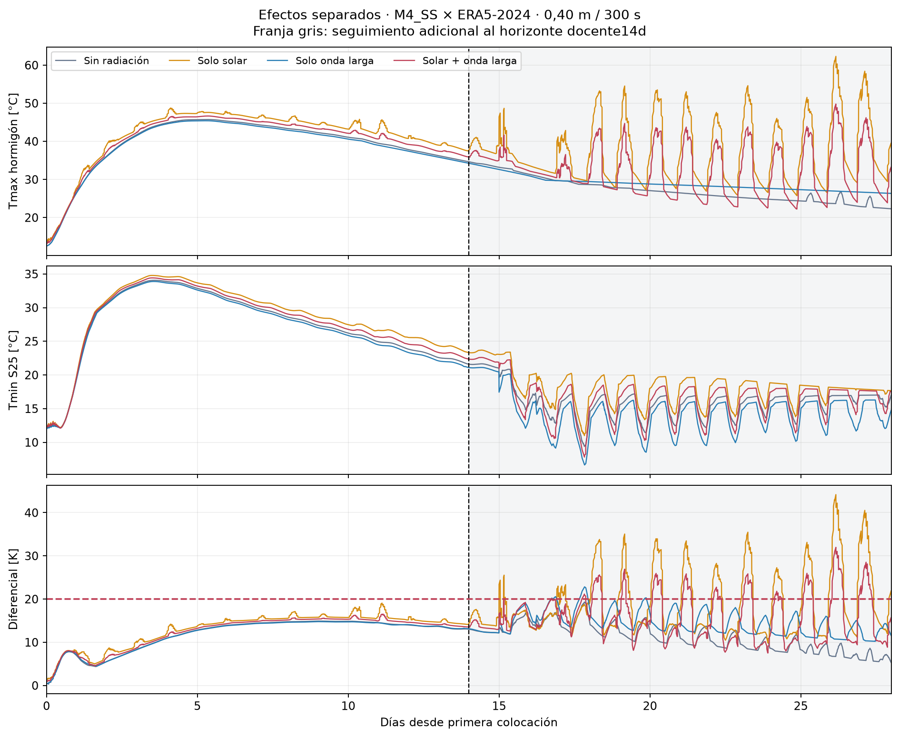
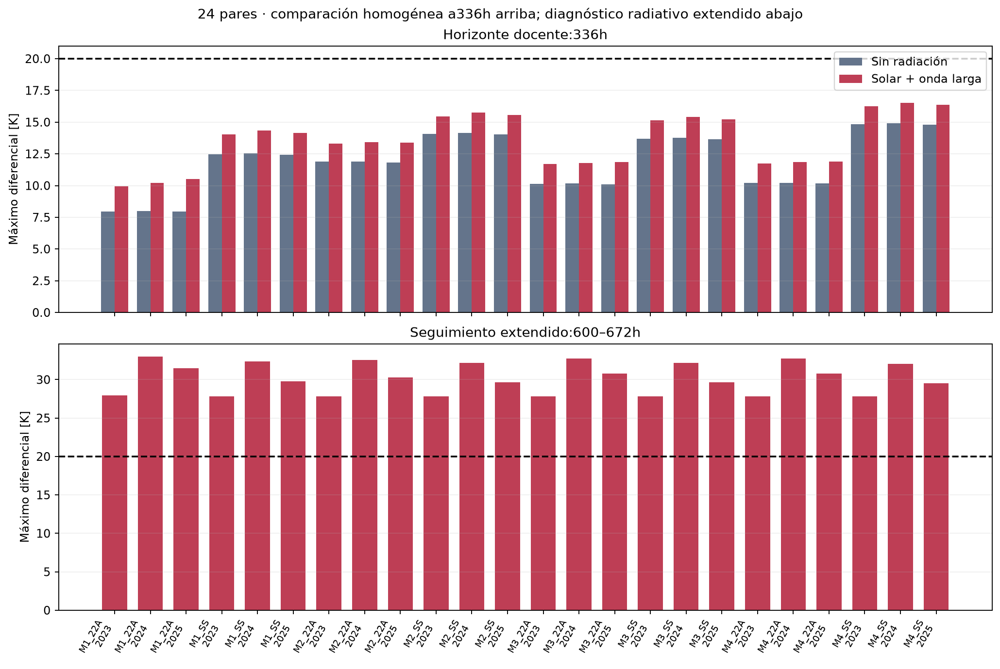
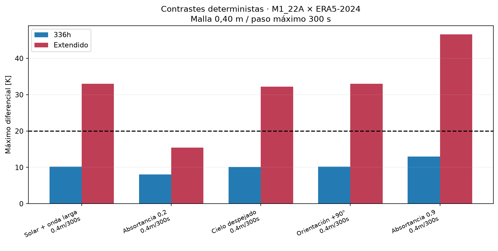
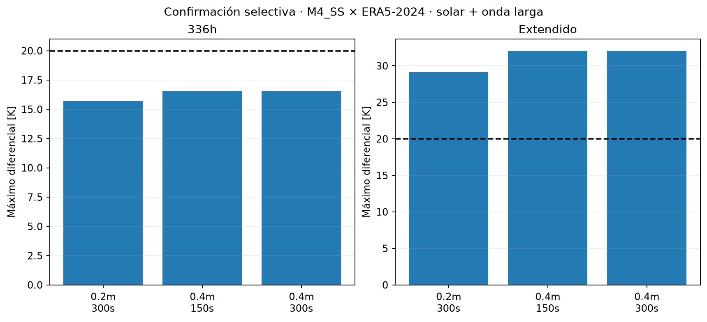

> Actualizacion posterior: la [comparacion vigente](COMPARACION_CIRCUITOS_FINAL.md) contiene cuatro planes con radiacion y matriz fina completa de24pares a336h. Este documento conserva el estudio inicial y su alcance original.

# Sensibilidad a radiación — resultado del 18/11/2026

**La omisión no es despreciable para esta propuesta.** Se conserva la evidencia anterior como modelo sin radiación. La radiación cambia temperaturas, diferenciales y el mecanismo que produce el máximo; el estudio extendido anterior no puede presentarse como confirmado al incluirla.

## Comparación aislada de mecanismos

M4_SS × ERA5-2024, misma malla de 0,40 m y paso máximo de 300 s. Los máximos de columnas distintas no necesariamente ocurren simultáneamente. ΔT siempre resta temperaturas del mismo instante.

| Intercambio exterior | Tmax a 14 días [°C] | ΔT a 14 días [K] | Tmax a 672 h [°C] | ΔT a 672 h [K] | Horizonte [h] | Alerta de pico pendiente |
|---|---:|---:|---:|---:|---:|---|
| Sin radiación | 45,7454 | 14,9147 | 45,7454 | 19,3581 | 672 | No |
| Solo solar | 48,7857 | 19,0892 | 62,4271 | 44,3024 | 672 | No |
| Solo onda larga | 45,4055 | 14,7841 | 45,4055 | 22,8359 | 672 | No |
| Solar + onda larga | 46,6574 | 16,5306 | 49,8807 | 32,0638 | 672 | No |

La radiación solar puede calentar una cara descubierta hasta convertirla en el punto más caliente: Tmax ya no tiene por qué estar en el núcleo. La onda larga aumenta las pérdidas hacia el cielo y puede enfriar S25 durante la noche. Ambos efectos actúan juntos y no se suman linealmente, porque modifican las temperaturas, la conducción y el control de circuitos. Las mantas atenúan el flujo mientras permanecen instaladas; el efecto se intensifica al retirarlas. La última manta se retira a 360 h de edad de cada capa, después del horizonte docente de 336 h: esto explica buena parte de la diferencia entre la conclusión a 14 días y el seguimiento posterior.

## Matriz combinada completa

Ocho fuentes × tres historias ERA5, 24 pares, pesos iguales a 1/24. Solo se agregan solar y onda larga al plan original; no se optimizan parámetros para obtener cumplimiento.

| Ventana | Mayor Tmax [°C] | Mayor ΔT [K] | Pares con Tmax>70 | Pares con ΔT>20 | P(unión) del catálogo |
|---|---:|---:|---:|---:|---:|
| 0–336 h, exigencia docente | 47,4941 | 16,5306 | 0/24 | 0/24 | 0.00% |
| 0–600/672 h, diagnóstico adicional | 50,1885 | 33,0074 | 0/24 | 24/24 | 100.00% |

Caso de mayor ΔT a 14 días: **M4_SS × ERA5-2024**. Caso de mayor ΔT extendido: **M1_22A × ERA5-2024**.

**16 pares conservan alerta de pico pendiente** al llegar a 672 h. Sus valores extendidos son máximos observados hasta ese horizonte, no máximos definitivos. Una excedencia ya observada es concluyente para esa ventana; ausencia de excedencia con alerta no certificaría el futuro.

El horizonte exigido sigue siendo14 días desde la primera colocación. Una falla posterior no debe contarse como falla del requisito14 días. Tampoco puede usarse el 0/24 anterior sin indicar explícitamente que se omitió radiación. Las frecuencias son exactas únicamente dentro del catálogo discreto adoptado: no se estiman intervalos binomiales de 24 ensayos aleatorios ni se demuestra riesgo real ≤ 5%.

## Propiedades, orientación y resolución

Contrastes en **M1_22A × ERA5-2024**, seleccionado por mayor diferencial nominal extendido. Estos contrastes no son una envolvente certificada de todos los posibles materiales, cielos u orientaciones.

| Variante | Malla [m] | Paso máximo [s] | ΔT a 14 días [K] | ΔT extendida [K] | Horizonte [h] |
|---|---:|---:|---:|---:|---:|
| ambas | 0.4 | 300 | 10,2287 | 33,0074 | 672 |
| clara | 0.4 | 300 | 8,0493 | 15,4727 | 672 |
| despejado | 0.4 | 300 | 10,0826 | 32,2027 | 672 |
| giro90 | 0.4 | 300 | 10,2287 | 33,0174 | 672 |
| oscura | 0.4 | 300 | 12,9591 | 46,6272 | 672 |

Absortancia solar de 0,6 y emisividad de 0,9 son hipótesis explícitas del acabado exterior equivalente, no propiedades medidas de las protecciones de obra. Se exploran absortancias de 0,2/0,9. Se estima cielo radiativo mediante punto de rocío y nubosidad total como proxy de nubosidad opaca; no hay medición de onda larga. Se suponen exposición sin sombras, difusa isotrópica y albedo de 0,2. Los refinamientos son selectivos: no constituyen una nueva matriz fina de 24 pares.

### Confirmación del piloto crítico de 14 días

| Caso M4_SS × ERA5-2024 | Tmax a 14 días [°C] | ΔT a 14 días [K] | ΔT extendida [K] |
|---|---:|---:|---:|
| ambas, 0.2m / 300s | 46,5397 | 15,7187 | 29,1367 |
| ambas, 0.4m / 150s | 46,6562 | 16,5292 | 32,0649 |
| ambas, 0.4m / 300s | 46,6574 | 16,5306 | 32,0638 |
| clara, 0.4m / 300s | 45,8285 | 15,0048 | 22,1197 |
| oscura, 0.4m / 300s | 47,9463 | 18,3322 | 45,4042 |

**Comparación pareada fina, únicamente 0–336 h:** sin radiación, ΔT=15,3007K; con radiación, ΔT=15,7187K. Cambio **0,4180K**. El incremento a 14 días es menor que en 0,40 m: no extrapolar el cambio grueso como efecto físico convergido. Ambos casos finos quedan bajo 20 K; no se ha repetido la matriz fina completa con radiación.

## Verificaciones y trazabilidad

Auditoría aprobada: **43 piezas de resultados y 2207 registros de transiciones de circuitos**. Dos piezas de la ventana común reutilizan resultados672 h existentes; no son simulaciones adicionales. Cada pieza incluye métricas336 h y seguimiento extendido; algunas realizan también extensión672 h. Se verificaron balance energético global, descomposición solar/convección/onda larga, residual superficial, potencia ≤ 15 kW, cobertura y umbrales19/18. Control sin radiación reproduce máximos originales con tolerancia 1e-9. Pruebas independientes: sol–aire analítica, Newton contra bisección y balance con refrigeración.

Los nuevos snapshots conservan exactamente el aire, viento y GHI originales. Se incorporaron DNI, DHI, punto de rocío y nubosidad con marcas temporales consistentes. La radiación se aplica al exterior de la protección, resolviendo su temperatura y atravesando su resistencia; no se inyecta directamente al hormigón a través de las mantas.

Método, ecuaciones, supuestos y fuentes: [protocolo](PROTOCOLO_RADIACION.md). Datos: `datos/clima/radiacion/manifiesto.json`. Resultados: `resultados/sensibilidad_radiacion/`. Tabla completa: [resultados CSV](evidencia_radiacion/resultados.csv). Ejecutor: `casos/sensibilidad_h/sensibilidad_radiacion.py`; auditor: `auditar_radiacion.py`.

## Consecuencia para la entrega

Presentar la propuesta con sus resultados por horizonte e incorporar radiación al modelo que se use para defender la decisión, o justificar y definir una protección real que modifique su exposición y volver a simularla. Este estudio no redimensiona tubos, cambia retiros ni valida una solución nueva. La comparación de 60/55/50/45 m³/h anterior sigue siendo una comparación sin radiación: no se ha repetido esa optimización completa con este intercambio.

Esta prueba de sensibilidad queda cerrada en el alcance descrito. En la presentación hay que distinguir el cumplimiento nominal observado a 14 días del diagnóstico posterior y declarar las propiedades superficiales supuestas. No se debe afirmar que la radiación es despreciable, que los refinamientos selectivos equivalen a una matriz fina completa con radiación o que los resultados garantizan riesgo real ≤ 5%.
