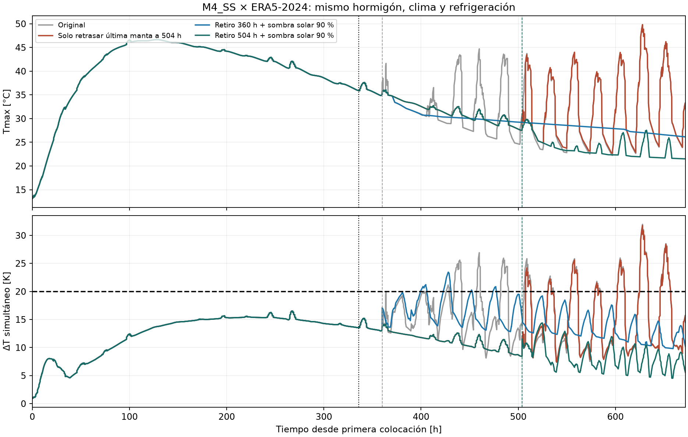
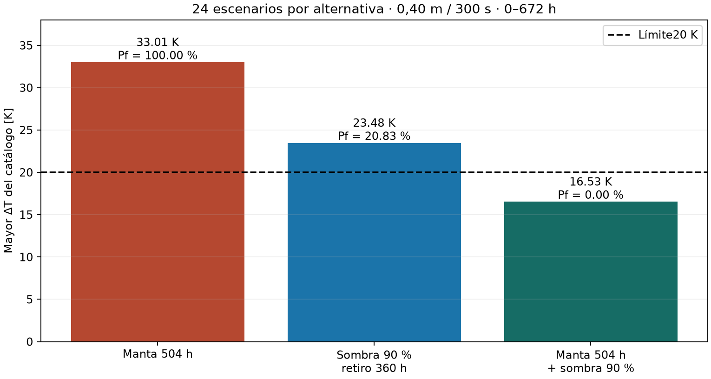

# Protección después del desmolde: tres alternativas simuladas

Estudio autorizado por el usuario. No modifica PPT, PDF, guion, brief ni la entrada numérica vigente. Las variantes son nuevas salidas, conservando los estudios anteriores.

## Qué se mantuvo y qué se cambió

Se mantienen60m³/h,12°C,11capas, nueve circuitos, agua ideal18°C,18L/min por ramal, bypass162L/min, Uv5W/(m³K), tope global15kW y control19/18sin corte global. Misma geometría, fuentes, clima, pesos y sitio. Madera18mm hasta72h y primera manta40mm hasta240h. Edades contadas desde activación de cada capa.

1. **Retraso:** última manta40mm hasta504h (21días) en lugar de360h. Después se descubre la cara, sin sombra.
2. **Sombra:** última manta hasta360h; luego transmitancia solar efectiva0,10 sobre todas las caras expuestas al aire de esa capa.
3. **Combinación:** última manta hasta504h y la misma sombra posterior.

**La sombra no es una manta adicional ni un cambio de absortancia del hormigón.** En el balance exterior se usa α·τ·I después del retiro local. Se mantienen convección y onda larga, incluido el cielo original; no se acredita una cubierta comercial ni se resuelven su temperatura, emisión infrarroja, influencia sobre viento o montaje. τ=0,10 es un supuesto de ensayo que necesitaría verificación para una instalación real. La cobertura se supone en caras superiores y laterales, no solamente un techo horizontal.

La sombra permanece hasta el final del seguimiento. No se simuló su desmontaje a672h ni se afirma cumplimiento indefinido tras retirarla. Mantener tubos no es un cambio nuevo: las tres alternativas conservan el control reversible previo.

## Resultados de los tres puntos

|Alternativa|Mayor Tmax [°C]|MayorΔT [K]|P_T|P_Δ|P_unión|Alertas de cola|
|---|---:|---:|---:|---:|---:|---:|
|Solo retrasar última manta a 504 h|49.9166|33.0081|0.00%|100.00%|100.00%|16|
|Retiro 360 h + sombra solar 90 %|47.4941|23.4772|0.00%|20.83%|20.83%|0|
|Retiro 504 h + sombra solar 90 %|47.4941|16.5306|0.00%|0.00%|0.00%|0|

Todas las filas contienen24pares completos (ocho fuentes×tres años), malla0,40m, paso máximo300s y ventana común0–672h. Pesos1/24. Los valores se deciden sin redondear. Máximos deT yΔpueden pertenecer a casos/horas distintos. Todas las variantes reproducen la historia previa y las métricas exactas0–336h del caso nominal, porque las medidas se activan después de esa ventana. No son24ensayos aleatorios ni probabilidad real garantizada.

## Interpretación física

Retrasar la manta reduce exposición durante un tiempo, pero al descubrir la superficie sigue existiendo el calentamiento solar posterior. La sombra con retiro a360h evita gran parte de ese calentamiento, pero no elimina el enfriamiento superficial nocturno mientras el interior conserva calor. La combinación permite que el volumen se enfríe con mayor resistencia exterior antes de descubrirlo y atenúa después las ganancias solares.

Ejemplo M4_SS×ERA5-2024: con sombra sola, a428h la máxima interior30,2942°C y la mínimaS25de6,8170°C producen23,4772K. El mecanismo no es el mismo que el pico de cara soleada del caso descubierto. Por eso no basta comparar únicamente Tmax o suponer que más enfriamiento siempre mejoraΔT.

## Confirmaciones de resolución

Los refinamientos siguientes son **selectivos**; no constituyen una matriz fina completa de24pares ni una probabilidad fina global. Se conserva la zona refrigerable414,016m³ y los tiempos físicos de colocación.

|Variante / curva / clima|Malla [m]|Paso máximo [s]|Tmax [°C]|ΔT [K]|CambioΔT frente a0,40m/300s [K]|Alerta|
|---|---:|---:|---:|---:|---:|---|
|combinada_504_sombra_90 / M4_SS×ERA5-2023|0.2|300|46.2820|15.7202|-0.5241|False|
|combinada_504_sombra_90 / M4_SS×ERA5-2024|0.2|300|46.5397|15.7187|-0.8119|False|
|combinada_504_sombra_90 / M4_SS×ERA5-2025|0.2|300|47.0322|15.5629|-0.8007|False|
|combinada_504_sombra_90 / M4_SS×ERA5-2024|0.4|150|46.6562|16.5292|-0.0014|False|
|combinada_504_sombra_90 / M4_SS×ERA5-2025|0.4|150|47.4930|16.3622|-0.0014|False|
|sombra_90 / M2_SS×ERA5-2024|0.2|300|45.4646|21.7710|-0.2692|False|
|sombra_90 / M4_SS×ERA5-2024|0.2|300|46.5397|22.9890|-0.4882|False|

En sombra sola se confirmaron 2pares fallidos con0,20m. Bajo pesos1/24, su peso conjunto ya aporta una cota inferior de8.3333%aP_unión en esa resolución. No es una estimación de la matriz fina completa; permite rechazarla si esa cota supera5%, sin depender del caso grueso marginal de20,028K.

## Conclusión y límites

La combinación cumple el requisito probabilístico del catálogo en0–672h: P_unión=0.0000%. Margen del mayorΔT grueso respecto de20K: 3.4694K. Las confirmaciones se informan por separado y no eliminan incertidumbre de modelo.

Alarmas de cola de la combinación: 0. Una ausencia de alarmas significa que el detector conservador no encontró indicadores de pico pendiente en esa historia climática; no demuestra un máximo universal bajo meteorología futura. Si hay alarmas, la captura de máximos sigue pendiente, aunque las excedencias ya observadas sean concluyentes.

Si se adopta esta alternativa, cambia la programación de protección, no el plazo10,6129h de colocación. El retiro504h sigue sujeto a resistencia, monitoreo y predicción. La ventana de unión, la transferencia real de tubos, el equipo frigorífico y la cubierta de sombra continúan como hipótesis o verificaciones constructivas, no quedan validados por estos números. No se ha resuelto fisuración mecánica.

504h es una edad ensayada favorable, no la edad mínima de retiro optimizada. Los tres ensayos corresponden a la candidata60m³/h; no se repitieron55/50/45m³/h con las nuevas protecciones. Si se incorpora una tabla de esos ritmos con protección revisada, deben calcularse sus filas de forma homogénea y no reutilizar las temperaturas antiguas como si fueran de esta configuración. La cota de duración V/60 conserva su significado bajo la capacidad máxima adoptada.

## Auditoría y reproducción

Auditoría aprobada: 79piezas, 3matrices completas y 2787transiciones. Se comprobaron hashes, pesos, indicadores, balance energético global y radiativo, potencia máxima, cobertura, histéresis, caudal con bypass y equivalencia antes de336h.

Configuración congelada del estudio: `casos/sensibilidad_h/proteccion_postdesmolde.json`. Motor: `proteccion_postdesmolde.py`. Auditor/agregador: `auditar_proteccion_postdesmolde.py`. Informe/figuras: `documentar_proteccion_postdesmolde.py`. Resultados originales en `resultados/proteccion_postdesmolde/`; resumen con confirmaciones y archivos por matriz. No editar scripts/config con hash para reanudar sus piezas.

Tablas adjuntas: `RESULTADOS_72_ESCENARIOS.csv` y `CONFIRMACIONES_SELECTIVAS.csv`. Las fechas de calendario se obtienen desde t₀=19/11/2026a10:00UTC−03:00: los retiros de última manta se distribuyen entre504y514,4210h por capa (10/12/2026aprox.10:00–20:25). No se trata de esperar504h después de terminar toda la fundación.
