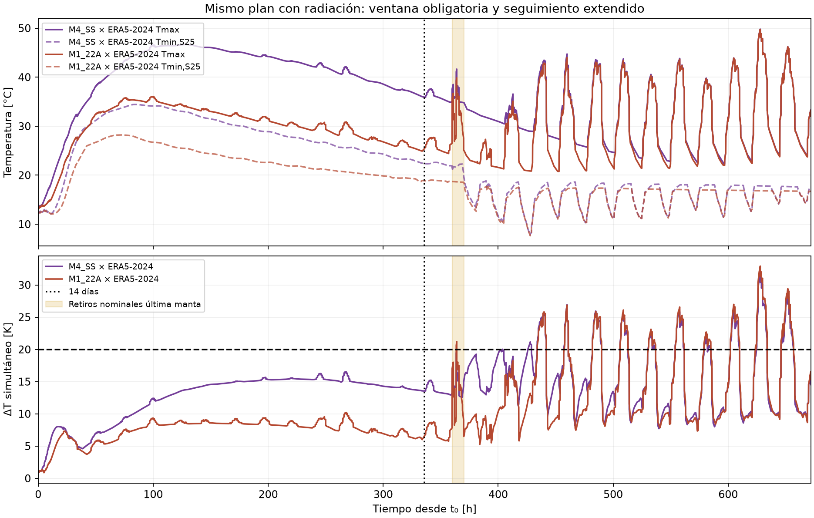

# Desarrollo para revisar F02: apartados 1 a 3.3

> Estudio posterior realizado por petición del usuario: [protección y sombra](../proteccion_postdesmolde/RESULTADO_TRES_ALTERNATIVAS.md). La combinación última manta504h+sombra solar90% cumple el catálogo grueso de24pares hasta672h, sin alertas y con confirmaciones selectivas. Este documento conserva el diagnóstico de la programación original360h sin sombra; no confundir su incumplimiento con el resultado de la alternativa nueva. La incorporación a PPT/guion sigue pendiente de terminar la revisión de todaF02.

Fecha: 18/11/2026. Documento previo a la actualización de diapositivas.
Alcance: únicamente los apartados que el usuario compartió en tres capturas.
No equivale a una auditoría de los apartados restantes de F02. PPTX, PDF,
guion y brief se conservan sin cambios hasta terminar la revisión completa.

## 1. Respuesta a la pregunta central y estado de la propuesta

La propuesta estudiada coloca la fundación en una operación continua de once
capas, con dos frentes de 30 m³/h, temperatura nominal de colocación de 12 °C,
nueve circuitos idealizados de agua a 18 °C y protecciones exteriores. Su
duración física es 10,6129192481 h. Es la menor posible bajo una capacidad
total máxima adoptada de 60 m³/h y sin esperas ni retrasos iniciales.

**La evidencia térmica tiene dos conclusiones diferentes:**

- En 0–336 h, los cuatro ritmos evaluados cumplen el catálogo discreto. La
  candidata de 60 m³/h tiene además matriz fina completa: Tmax 47,0322 °C,
  ΔT máximo 15,7202 K, sin excedencias en sus 24 pares.
- La candidata nominal con radiación, en 0–672 h y malla de 0,40 m,
  supera el límite de diferencial en los 24 pares. Por tanto, la misma
  programación de protecciones no es una solución acreditada para ese
  seguimiento. No se puede recomendar como plan térmico completo basándose
  exclusivamente en el resultado favorable de los primeros 14 días.

La pregunta central queda respondida de forma **condicionada en 14 días**,
pero la aceptación global del plan sigue abierta por el horizonte extendido
y la validación constructiva. La pauta pide extender cuando corresponde;
no permite obtener una ventaja al truncar la respuesta térmica. Mantener
la distinción entre ventanas es correcto; utilizarla para ignorar las
excedencias posteriores sería incorrecto.

Redacción preparada para la exposición futura:

> Con los recursos máximos adoptados, la colocación continua requiere
> 10,61 horas. El catálogo con radiación cumple durante los primeros 14 días,
> incluso al refinar la candidata. Sin embargo, el retiro nominal de la última
> manta produce excedencias posteriores en todos los escenarios gruesos.
> Por ello, el plazo mínimo de colocación está calculado, pero la programación
> completa de protección y liberación térmica requiere revisión antes de
> declarar una solución final factible.

No afirmar que 0/24 demuestra riesgo real cero ni que cumplir los indicadores
demuestra ausencia de fisuración. Se trata de criterios térmicos docentes.

## 2. Formato, tiempo y consulta sin internet

Se conserva el reparto de ocho principales: Benjamín S1–S3, Luis S4–S5,
Matías S6–S8. Los intervalos del guion suman 420 s. Son un presupuesto,
no una medición de ensayo. Los respaldos B01–B12 se consultan durante
preguntas, fuera del recorrido principal. Cualquier integrante debe poder
explicar cualquier tema.

Preparación del ensayo, sin declarar actividades no realizadas:

1. Ejecutar el recorrido con los tres integrantes y cronómetro, incluyendo
   clics y cambios de expositor. Registrar tiempo real por integrante y total.
2. Ajustar el discurso para terminar antes de 7 min; no acelerar ecuaciones
   o explicaciones esenciales para conservar texto accesorio.
3. Practicar preguntas cruzadas: Benjamín explica probabilidad y S25; Luis,
   secuencia constructiva y recursos; Matías, intercambio físico y controles.
4. Preparar respuestas de aproximadamente 30–45 s. Distribuir las preguntas
   entre los tres durante los 5 min disponibles.
5. Abrir PPTX y PDF en el equipo de exposición sin conexión, comprobar fuentes,
   animaciones, navegación y acceso a tablas de escenarios. El PDF es estático.

Se verificó existencia e integridad mediante SHA256 de **167 archivos locales**
en `INVENTARIO_OFFLINE.json`: presentación, guion, configuraciones, resultados
de comparación y seguimiento. Esto no acredita copia a otro computador,
ensayo realizado, compatibilidad de animaciones en otro visor o SHA final de
entrega. La defensa no necesita recalcular ni acceder a servicios web.

Material nuevo para consulta: `CRONOGRAMA_44_CAPAS.csv`,
`METRICAS_24_PARES_336_672.csv`, `RESUMEN.json` y
`HORIZONTES_336_672.png`. Todos quedan junto a este documento.

## 3.1. Objetivo temporal, inicio común y recursos

### Inicio y definición de duración

Se recupera el inicio ya usado en la configuración congelada; no se cambia
el acoplamiento climático ni se desplaza el inicio para favorecer el resultado:

**t₀ = jueves 19/11/2026, 10:00:00, UTC−03:00; zona America/Santiago.**
Representación ISO: `2026-11-19T10:00:00-03:00`. Es un inicio constructivo
hipotético y no la hora de la exposición ni un pronóstico meteorológico.

Para el plan u:

\[
D(u)=\max_j t_{j,\mathrm{fin}}-t_0.
\]

Los tiempos de colocación se expresan respecto de ese mismo origen. D incluye
descarga, colocación y esperas, incluida una postergación de la primera capa.
No se reinicia el reloj si se posterga el trabajo. El enfriamiento posterior
no integra D y se informa por separado.

Con caudal total constante q, sin solapamiento entre capas y sin esperas:

\[
\tau_j=V_j/q,\qquad s_1=0,\qquad
s_{j+1}=s_j+\tau_j,\qquad D=\sum_j\tau_j=V/q.
\]

Si aparecen retraso inicial δ y esperas wⱼ, entonces
D = δ + Στⱼ + Σwⱼ. Esto aumenta duración y desplaza las activaciones respecto
del clima; por ello, sus consecuencias térmicas deben recalcularse.

### Cronograma físico de la candidata

Valores redondeados para lectura; el CSV conserva precisión completa y
marcas ISO de inicio/término para los cuatro planes, 44 filas en total.

| Capa | Cotas z [m] | Volumen [m³] | Inicio [h] | Duración [h] | Término [h] |
|---|---|---:|---:|---:|---:|
|1|0,00–0,40|107,3642|0,0000|1,7894|1,7894|
|2|0,40–0,80|107,3642|1,7894|1,7894|3,5788|
|3|0,80–1,20|106,6255|3,5788|1,7771|5,3559|
|4|1,20–1,60|90,3262|5,3559|1,5054|6,8613|
|5|1,60–2,00|69,7812|6,8613|1,1630|8,0244|
|6|2,00–2,40|51,8871|8,0244|0,8648|8,8891|
|7|2,40–2,80|36,6441|8,8891|0,6107|9,4999|
|8|2,80–3,20|24,0520|9,4999|0,4009|9,9007|
|9|3,20–3,60|15,8685|9,9007|0,2645|10,1652|
|10|3,60–4,00|15,3499|10,1652|0,2558|10,4210|
|11|4,00–4,30|11,5124|10,4210|0,1919|10,6129|

Término de toda la colocación: aproximadamente **19/11/2026, 20:36:47,
UTC−03:00**. No es el término de refrigeración ni autorización para retirar
protecciones. La integración geométrica de capas da 636,7751548866 m³;
el volumen de la malla triangular IFC es 636,7751926932 m³. La diferencia
de aproximadamente 0,000038 m³ es numérica; la duración se calcula con los
volúmenes de las capas que construyen el cronograma.

### Recursos y restricciones comunes

En los cuatro planes se conservan geometría, volumen físico, once capas,
12 °C nominales, nueve ramales, agua ideal a 18 °C, Uv=5 W/(m³K), tope
conjunto de 15 kW, control 19/18, materiales y edades de retiro, t₀, historias
climáticas, fuentes y pesos. Se conserva la capacidad disponible de dos
frentes de hasta 30 m³/h cada uno. Los ritmos inferiores usan una fracción
de esa misma capacidad; no reciben otros equipos o una mezcla favorable.

No hay colocación simultánea de dos capas completas: la simultaneidad
admitida es de dos frentes dentro de la capa en ejecución. Los dos caudales
se suman para obtener q. No se aplican 60 m³/h a cada frente.

No se espera endurecimiento entre capas. Se propone continuidad con recorrido
y vibrado repetibles. La condición de unión de 150 min es un requisito de
aceptación por demostrar, no una medición de fraguado. La capa mayor requiere
107,4 min a60 y143,2 min a45 m³/h. Esa comparación no demuestra por sí sola
la aptitud de toda interfaz real: deben verificarse mezcla, retorno local,
recorrido, accesibilidad y vibración. Una pérdida de continuidad exige revisar
la junta y el plan, en lugar de seguir afirmando una operación monolítica.

Los moldajes y mantas se retiran nominalmente a edades locales72/240/360 h.
La fecha no equivale a permiso automático. Los resultados extendidos muestran
que esa programación debe revisarse. El esquema actual no dimensiona montaje,
hidráulica ni transferencia real de pared de tubos.

### Por qué 10,61 h es una cota bajo estos recursos

Para cualquier plan que use el mismo volumen y no supere60 m³/h en total:

\[
D\ge V/q_{\max}=636.7751548866/60=10.6129192481\ \mathrm h.
\]

El plan continuo alcanza la cota de colocación al utilizar la capacidad desde
t₀ y evitar esperas. Los demás ritmos producen11,5777/12,7355/14,1506 h.
Una duración menor exige cambiar recursos, volumen u otra restricción. No
se ha demostrado que75 m³/h falle térmicamente ni un óptimo universal.
Alcanzar la cota temporal no prueba factibilidad térmica del seguimiento.

### Activación numérica frente a colocación física

El solver activa **todas las celdas de una capa al inicio programado de esa
capa**, a12 °C. No simula el frente horizontal de descarga, el llenado
continuo dentro de la capa ni edades distintas dentro de ella. Las demás
capas permanecen inactivas hasta su inicio.

La duración física de cada capa se conserva en el cronograma y en D, aunque
no se represente como llenado continuo en el solver. La última capa se
activa a10,4210 h, pero la colocación termina a10,6129 h. Usar la última
activación como D subestimaría el plazo en aproximadamente11,51 min.

Esta aproximación adelanta la presencia de parte del volumen, su hidratación,
la cobertura de interfaces y sus edades de retiro respecto de un frente real.
No se ha determinado un signo conservador para el error en Tmax oΔT. El
refinamiento de malla/paso no valida esta hipótesis constructiva. Para
cuantificarla haría falta otro estudio de subcapas o llenado progresivo con
el mismo volumen y recursos. Se declara como simplificación del modelo.

## 3.2. Dominio, S25 y métricas por simulación

### Dominio activo

Ωc(t) contiene únicamente celdas de hormigón cuya capa ya fue activada.
Se excluyen aire, reservorio de suelo y capas futuras. La temperatura del
suelo, del aire o del agua no puede sustituir Tmin,S25. Al añadir una capa,
se amplíaΩc y se actualiza la conectividad entre vecinos activos.

### Cómo se actualiza S25

El código identifica las caras de celdas activas cuyo vecino no existe o
todavía está inactivo. Son el contorno de hormigón existente en ese instante.
En cada cara se reconstruye un punto aproximadamente25 mm hacia el interior.
Se incluye el contorno de base en contacto con suelo y las demás superficies
del hormigón; no el exterior de la manta ni celdas del suelo.

Cuando se activa la capa siguiente, una cara que ahora conecta dos celdas
activas se convierte en interfaz de conducción interna. Deja de intercambiar
con el ambiente y deja de aportar puntos a S25 como superficie exterior.
Las caras nuevas expuestas de la capa añadida pasan a integrar el contorno
y S25. Se supone contacto térmico perfecto entre hormigones.

Las caras escalonadas son las de la geometría voxelizada, no una superficie
IFC exacta. Hay muestras por cara; la mínima de ellas aproxima el mínimo
del conjunto S25. La evaluación considera los estados anterior y posterior
a eventos de activación y cambio de contorno, sin suavizar sus saltos.

### Reconstrucción cuando la malla es gruesa

Con Ti la temperatura de centro, k la conductividad del hormigón, d=h/2
la distancia centro–cara y q″ el flujo entrante al hormigón por unidad de área:

\[
T_{f,c}=T_i+q''d/k,\qquad
T_{25}=T_i+q''(d-0.025)/k.
\]

El signo es coherente con el flujo positivo entrante. Por ejemplo, si una
superficie está perdiendo calor, q″<0 y la reconstrucción bajo ella resulta
más fría que el centro. Para h0,40 m,d0,20 m; para h0,20 m,d0,10 m.
En ninguno de ambos casos se ha resuelto una celda de25 mm. Es una
reconstrucción lineal local, cuya sensibilidad espacial debe declararse.

Con radiación y mantas, la temperatura exterior Ts se obtiene del balance
no lineal convección+solar+onda larga. El flujo que atraviesa la protección
se utiliza después para reconstruir el contorno del **hormigón**. Ts no se
usa como si fuera T25. Tmax también compara centros activos y caras del
hormigón reconstruidas, porque el sol puede convertir una cara en el punto
más caliente.

### Definiciones que se mostrarán en respaldo

\[
M_T(u,s;H)=\max_{0\le t\le H}\max_{x\in\Omega_c(t)}T(x,t),
\]
\[
M_\Delta(u,s;H)=\max_{0\le t\le H}
\left[\max_{x\in\Omega_c(t)}T(x,t)-\min_{x\in S_{25}(t)}T(x,t)\right].
\]

Se calcula primero la diferencia en el mismo instante y después el máximo
temporal. No se resta un pico de temperatura y una mínima histórica de
horas distintas. Se conservan hora, posición, capa y fase del evento.

Ejemplo ya calculado: M4_SS×ERA5-2024,0,40 m/300 s, a267 h:
42,120249−25,589656=16,530593 K. El punto caliente es una cara reconstruida.
Su pico histórico de46,6574 °C ocurre en otro instante y no entra en esa resta.

### Horizonte obligatorio y extensión comprobada

El horizonte de14 días termina el **03/12/2026 a10:00 UTC−03:00**. El
seguimiento común de672 h termina el **17/12/2026 a10:00 UTC−03:00**.
Se comprobó que las24 piezas nominales gruesas tienen exactamente672 h,
por lo que se puede mostrar una tabla homogénea, sin mezclar600 y672 h.

| Ventana y resolución | Mayor Tmax [°C] | MayorΔT [K] | P_T | P_Δ | P_unión |
|---|---:|---:|---:|---:|---:|
|0–336 h;0,40 m/300 s;24 pares|47,4941|16,5306|0 %|0 %|0 %|
|0–672 h;0,40 m/300 s;los mismos24 pares|50,1885|33,0074|0 %|100 %|100 %|
|0–336 h;0,20 m/300 s;24 pares|47,0322|15,7202|0 %|0 %|0 %|

La fila fina confirma únicamente336 h. No se presenta una matriz fina
extendida inexistente. Las máximas deT yΔ pueden corresponder a pares
y horas diferentes. Valores exactos por par en el CSV adjunto.

En las24 historias guardadas hay al menos una muestra con excedencia antes
de600 h. Se registra la primera muestra fallida, que **no es necesariamente
el instante exacto del primer cruce**. Es suficiente para demostrar que el
incumplimiento posterior no nace solo por extender de600 a672 h. No se han
reconstruido máximos exactos a600 h desde un muestreo menos denso.

La última manta se retira nominalmente entre360 y370,4210 h, contando edad
desde la activación de cada capa. Ese cambio posterior a336 h reduce la
resistencia al intercambio exterior. La coincidencia de retiros y aumento
del diferencial explica un mecanismo plausible; no se afirma que sea la
única causa ni que una alternativa de retiro aún no simulada cumpla.

### Qué significan las16 alertas y qué puede cerrarse

La alarma conservadora del ejecutor se activa por: edad insuficiente desde
la última colocación; máximo en las últimas24 h; temperaturas o diferencial
en la cola a menos de0,01 K del máximo observado; o aumento de Tmax final
mayor de0,05 K respecto del comienzo de esa cola. Es una señal para revisar
el horizonte, no una prueba de crecimiento indefinido. Con forzamiento
meteorológico diario puede repetirse un pico cercano.

Dieciséis pares conservan alarma a672 h. Sus valores se denominan **máximos
observados**, nunca máximos definitivos. Capturar otros mayores exigiría
extender coherentemente aire, viento, radiación y demás entradas, además
de repetir el cálculo. No se prolonga un clima repitiendo su último valor
sin declarar otra hipótesis; tampoco hay un máximo físico universal para
una exposición meteorológica futura ilimitada.

**La clasificación fallida del seguimiento ya es concluyente:** si el
evento es exceder un límite al menos una vez, prolongar el cálculo no puede
borrar una excedencia previa. Por tanto, no hace falta perseguir un máximo
más alto para rechazar esta programación en la ventana extendida. Sí queda
pendiente capturar los máximos relevantes que la pauta exige informar y
validar una programación revisada antes de recomendar liberación térmica.

Próximo problema físico, separado de esta preparación documental: revisar
exposición/protecciones y sus retiros o el control térmico, manteniendo
recursos y geometría explícitos; comparar una alternativa con radiación
durante336 h y un horizonte común que incluya sus cambios de protección;
extender si persisten alarmas, y confirmar resolución de los casos decisivos.
No se fija aquí una fecha de retiro nueva ni se atribuye cumplimiento a
una alternativa no calculada.

## 3.3. Indicadores y probabilidad del evento conjunto

Para cada escenario s y ventana H:

\[
I_T=\mathbf1\{M_T>70\ ^\circ\mathrm C\},\qquad
I_\Delta=\mathbf1\{M_\Delta>20\ \mathrm K\},\qquad
I_F=\max(I_T,I_\Delta).
\]

\[
P_T=\sum_s w_s I_T,\quad P_\Delta=\sum_s w_s I_\Delta,\quad
P_f=\sum_s w_s I_F,\qquad \sum_s w_s=1.
\]

Una corrida que supera ambos límites cuenta una sola vez. Los umbrales
se evalúan con desigualdad estricta:70 °C y20 K exactos no son excedencia.
La aceptación se decide con el valor sin redondear:Pf≤0,05. Un5,004 %
incumple aunque se vea como5,00 % en una tabla redondeada.

En el catálogo adoptado, ocho curvas completas×tres climas pesan1/24 cada
una. Una falla pesa4,166666… % y dos8,333333… %. Son ejemplos aritméticos,
no fallas observadas en336 h ni una muestra aleatoria para un intervalo
binomial. La exactitud de la suma del catálogo no elimina incertidumbre
de modelo, pesos o escenarios ausentes.

Con radiación: a336 h,I_F=0 en24 pares; a672 h,I_T=0 eI_Δ=I_F=1 en los
mismos24 pares gruesos. La probabilidad cambia al cambiar la ventana del
evento; por eso debe mostrarse H junto a cada resultado.

El mayor cambio espacial pareado observado en336 h es1,1746 K y el
temporal0,0014 K en tres pares. La candidata fina mantiene margen nominal
de4,2798 K. Es evidencia de sensibilidad, no cota rigurosa del error ni
convergencia asintótica. Si una alternativa nueva queda tan cerca del límite
que la resolución puede cambiar su clasificación, hay que refinarla o
declarar el cumplimiento indeterminado. No se corrigen indicadores
redondeando ni restando arbitrariamente un error favorable.

## Estado de cierre y contenido reservado para el futuro PPT

| Pendiente detectado | Desarrollo realizado | Estado |
|---|---|---|
|Inicio común y zona|t₀ recuperado y fechas completas|Documentado|
|Objetivo D con esperas|Definición, fórmulas y cota bajo recursos|Documentado|
|Duración de cada capa|44 filas: cuatro planes y once capas|Calculado y comprobado|
|Activación instantánea|Inicio de capa, diferencia frente a duración física y limitaciones|Documentado; error de aproximación no cuantificado|
|Dominio y S25 dinámicos|Selección de caras, cambios de interfaces y reconstrucción25 mm|Contrastado con implementación|
|Ambos horizontes|24 pares a336/672 h y gráfico|Calculado desde resultados existentes|
|Evento conjunto|Tres indicadores, pesos y decisión sin redondeo|Documentado y comprobado|
|Máximos extendidos definitivos|16 alarmas; sin certificación de máximos futuros|Pendiente físico/numérico explícito|
|Plan completo factible|Excedencia observada en24/24; requiere revisar protección/control|Pendiente; no se afirma solución final|
|Disponibilidad local|167 archivos inventariados con hash|Comprobada en este equipo|
|Ensayo y traslado al equipo de defensa|Protocolo preparado|Pendiente humano|

Al terminar de revisar el resto de F02 se incorporarán: inicio y duración
general en S3/S7; cronograma en respaldo; explicación deΩ/S25 en S2 y
respaldo técnico; tabla y gráfico de ambos horizontes; indicadores completos
en B09; y una conclusión que refleje el estado real del plan. No cambiar
las diapositivas ni declarar todos los requisitos cerrados antes de esa
revisión y de resolver la factibilidad pendiente.

## Procedencia y reproducción

Ejecutor sin solver: `casos/sensibilidad_h/desarrollar_revision_f02.py`.
`RESUMEN.json` conserva hashes de cronograma, configuración y24 piezas
extendidas. El inventario conserva hashes de resultados336 h y archivos
de exposición. Se conservaron los resultados originales y los scripts
numéricos con procedencia congelada. No se modificaron IFC, matrices,
PPTX, PDF, guion o brief. No se ejecutaron simulaciones nuevas: las corridas
existentes bastan para los cálculos documentales y la clasificación observada.
